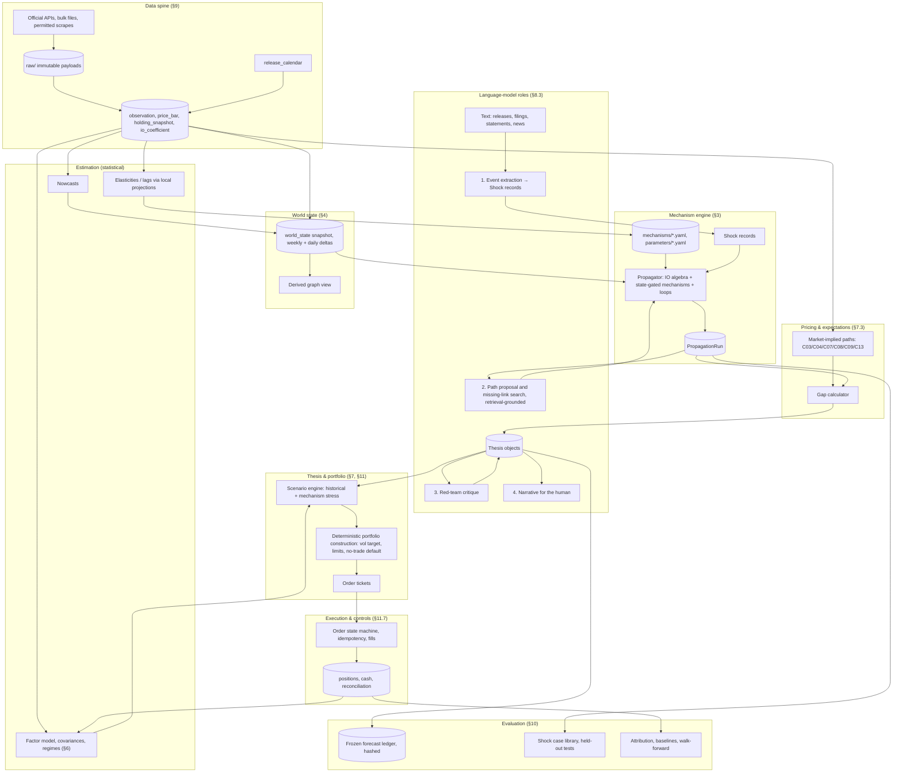

# Global Macro, Cross-Asset Research & Trading System — Specification and Build Plan

**Date:** 2026-10-14. **Status:** design only. Nothing in this document purchases a subscription, opens an account, places a trade, or builds the live system.

**Scope sentence.** A system that takes an economic change, traces its direct and indirect consequences through production, balance sheets, policy, and currencies, subtracts what markets already price, and converts the residual into sized positions in liquid ETFs on a weekly cycle with daily monitoring — built so the same machinery handles a housing expansion, a funding squeeze, or a chokepoint closure as readily as an AI-capex copper thesis.

---

## 0. How to read this document

**Claim labels.** Every substantive statement carries one of four tags so a reader can tell a fact from a bet:

| Tag | Meaning | How to treat it |
|---|---|---|
| **[M]** | Established mechanics: accounting identity, no-arbitrage relation, documented institutional rule, or verified provider fact | May be relied on. Identities are used as consistency checks. |
| **[E]** | Empirical regularity with literature support; magnitude varies by country, period, regime | Direction usually dependable; magnitude must be estimated locally and re-checked. |
| **[H]** | Hypothesis | Must be tested before it influences sizing. |
| **[J]** | Design judgment | A choice among defensible alternatives; the tradeoff is stated. |

**Provider facts** (prices, limits, terms) were read from the cited pages on **2026-10-14** unless a different date is given. They change; the source plan (§9.6) records the verification date next to each fact.

**No fabricated numbers.** Where a magnitude matters and the literature supports a range, the range is given with its source. Where it does not, the document says "estimate locally" and names the data that would estimate it. No probabilities, coefficients, forecast returns, or live market readings are invented.

**Structure.** §1–2 define the problem and the expert checklist. §3 is the reusable mechanism library. §4–5 define the world model and the FX layer. §6–7 cover risk monitoring and the bridge from economics to returns. §8 is architecture, §9 data and budget, §10 evaluation, §11 trade lifecycle, §12 worked examples, §13 backlog, §14 anti-rot rules, §15 open decisions, Appendix A references, Appendix B verified-provider table, Appendix C review of the companion plan (`portfolio-model-plan.md`, 2026-10-13).

---

## 1. The problem, stated precisely

### 1.1 The loop the system runs

```
  SHOCK ──► PROPAGATION ──► PRICING GAP ──► POSITION ──► MONITOR / FALSIFY ──┐
    ▲        (mechanisms,     (what is        (sized,       (evidence arrives,  │
    │         world state)     already in      hedged,       thesis updated     │
    │                          prices?)        bounded)      or killed)         │
    └──────────────────────────────────────────────────────────────────────────┘
```

Each stage is a separate module with its own tests. The loop is run weekly for decisions and daily for monitoring. It must produce a **no-trade** output by default; a trade is the exception that clears four gates (§11.3).

The loop also runs **backward** (explanation mode): given an unusual market move, enumerate the shocks that could produce it through the library, rank them by the evidence each would leave (the `evidence` field of every mechanism), and check which other exposures those candidate shocks would touch. Several mechanisms can explain one observation; explanation mode returns a ranked set with the discriminating observables, never a single story.

### 1.2 Four constraints that shape every design choice

1. **Edge must come from reasoning, not speed.** [J] With daily data and weekly decisions, nothing here competes on latency. The system's only possible advantages are (a) tracing second- and third-order consequences more systematically than discretionary analysts, (b) being disciplined about what is already priced, and (c) sizing honestly under uncertainty. Everything else is a cost.
2. **Instruments are ETFs, so the atomic unit of expression is a basket exposure.** [M] An ETF is a weighted bundle of holdings with a currency decomposition, a structure (physical, synthetic, futures-based), and a cost. A thesis about copper or Japanese banks has to survive translation into a basket that also carries everything else in it. This forces the exposure-accounting discipline of §4.2 and §5.4 from day one.
3. **Recurring spend under $50/month.** [M] Official statistical APIs are free (§9.6). Price data for a few dozen ETFs is free or nearly so. The binding costs are LLM tokens and, if used, one paid price feed. The budget forces a design where the model layer is bounded and most computation is deterministic.
4. **One person plus agents maintain it.** [J] Testability beats cleverness. Parameters live in data files, not code. Mechanisms are small, typed, and individually falsifiable. There is no giant prompt, no Kubernetes, and no untestable rule.

### 1.3 Why a knowledge graph alone is not a causal model

A graph records *that* data centers use electricity and that transformers use copper. A causal model must answer, for a specific shock in a specific state of the world:

- **How much?** A unit of final demand in industry *j* of country *c* requires how much gross output from every upstream (country, industry) pair — a quantity, with units, from input-output structure (§3, A4/B1).
- **How fast?** Orders respond now; shipments respond after inventories are drawn (B4); capacity responds after lead times (B5); prices respond when the supply curve goes vertical (B3).
- **With what sign under which state?** A demand shock when inventories are high and capacity idle moves volume; the same shock when both are tight moves price. The edge's sign and magnitude are state-dependent.
- **What else moves?** Substitutes, complements, FX, policy reaction, and financing all create competing effects that can reverse the naïve conclusion.
- **What is already priced?** Markets may have discounted most of the path. The tradable quantity is the gap, not the level.

The graph is therefore a *view* over a relational world state plus a library of parameterized mechanisms (§4.4). Edges carry mechanism IDs, parameter references, horizons, and state conditions; running a propagation is executing a typed computation, not walking links.

### 1.4 What "expert" means operationally

An expert is not someone who knows more facts; it is someone whose reasoning reliably passes a checklist. The system is held to that checklist (§2 and §10.2):

- Converts every claim to units and checks accounting identities before accepting it.
- States horizon and lag for every effect; does not conflate an order with a delivery or a plan with capacity.
- Lists competing effects and asks which dominates in the current state.
- Separates expectation from realization and asks what consensus and prices already assume.
- Distinguishes a growing industry from a good investment (§7.2).
- Knows when evidence is insufficient and says "no trade" (§11.3).
- Keeps a signed, timestamped forecast log and scores it (§10.3).

### 1.5 Full target vs. initial operational version

The same concepts apply to both; the initial version (v0) differs in coverage and automation, not in kind. [J]

| Dimension | Full target | v0 (first operating version) |
|---|---|---|
| Economies | ~40 with full balance-sheet detail | ~15 (US, euro area + DE/FR/IT, UK, JP, CN, KR, TW, IN, BR, MX, CA, AU, CH) |
| Industries | OECD ICIO 50 industries × economy, with sub-industry overlays where material | ICIO 50 industries as published; ~30 commodities |
| Mechanisms | Full library (§3), parameters estimated per economy | ~25 mechanisms with literature-range or locally estimated parameters |
| Pricing-gap module | Market-implied paths for rates, inflation, commodities, FX forwards, options surfaces | Rates (Treasury/ECB curves), breakevens, futures curves (delayed), equity multiples; FX forwards/basis as flagged gap |
| Risk | Factor model + stress scenarios + regime indicators | Same structure; fewer factors; weekly update |
| LLM roles | Event extraction, path proposal, critique, narrative | Same four roles; smaller volumes; human review of every path proposal |
| Execution | Automated order management with reconciliation | Paper trading, then manual-approve order tickets generated by the system |
| Evaluation | Full walk-forward + frozen-forecast ledger + out-of-sample shock library | Frozen-forecast ledger from week 1; historical case library of ≥ 12 shocks |

---

## 2. Capability map — what the system must know and do

Each row names the knowledge, the operational behavior, the observable evidence, and the classic trap. The traps are what the evaluation harness (§10) tests for.

| Domain | Must know | Must do | Observable evidence (sources §9.6) | Classic trap |
|---|---|---|---|---|
| **Real activity** | GDP identity and its components [M]; stocks vs flows; inventory cycle [E]; capacity utilization; order→shipment→production lags; nowcasting | Convert a shock into Δ final demand by (country, industry); propagate through IO; nowcast current-quarter activity | National accounts, IP, retail sales, PMIs (headline), orders/shipments, GDPNow / NY Fed Nowcast, PortWatch trade volumes | Treating announced investment as realized spending; ignoring import leakage |
| **Labor** | Okun [E]; participation and hours margins; wage–price link weak and variable [E]; unit labor costs | Map output changes to employment and wages with lag; use ULC for margin and inflation implications | Payrolls, JOLTS, claims, ECI, Atlanta Fed wage tracker, euro-area negotiated wages | Reading one payroll print as a trend; confusing tightness with inflation |
| **Inflation** | Index construction (CPI/PCE/HICP weights) [M]; core vs headline; pass-through from FX, commodities, wages [E]; expectations anchoring | Decompose an inflation forecast by component; compare with breakevens and surveys; predict policy reaction | CPI/PCE/HICP detail, PPI, import prices, breakevens, Cleveland Fed expectations, SCE | Assuming full pass-through; forgetting shelter lags in US CPI |
| **Banking & credit** | Bank balance-sheet identity [M]; lending standards → credit → activity [E]; financial accelerator [E]; funding markets (repo, CP, FX swaps) | Track credit impulse; detect funding stress; map a shock to collateral and lending capacity | H.8, SLOOS, ECB Bank Lending Survey, H.4.1, SOFR/repo, CP rates, ICE BofA OAS, BIS banking stats | Treating a liquidity squeeze as solvency, or the reverse |
| **Fiscal** | Debt dynamics identity [M]; multipliers state-dependent [E]; issuance and term structure; automatic stabilizers | Convert a fiscal change into Δ demand by sector and Δ issuance; check against deficit arithmetic | Treasury Fiscal Data (daily), CBO, Eurostat government finance, IMF Fiscal Monitor | Scoring a headline number without timing, composition, or financing |
| **Monetary** | Reaction functions; transmission channels and lags [E]; balance-sheet policy; FX intervention; forward guidance; information effects [E] | Infer the market-implied path; model the reaction to the shock; map to curve and FX | Policy statements, minutes, projections, Fed funds futures (FedWatch view), OIS where available, H.4.1 | Forecasting the economy but not the central bank's response to it |
| **Industry economics** | Cost structure and materiality [E]; capacity, lead times, utilization; marginal pricing [E]; concentration and value capture [E]; substitutes/complements | Build a per-industry sheet: cost shares, capacity pipeline, inventory days, pricing power | IO tables (BEA, ICIO), trade data (Comtrade), company filings (EDGAR XBRL), agency statistics (EIA, USDA, USGS) | Assuming the firm that uses more of X profits from X; ignoring entry |
| **Equities** | Earnings → FCF → valuation [M/E]; duration of equity; sector/country composition of indices; discount-rate vs cash-flow news [E] | Translate sector outcomes into index-level earnings and multiple changes; check positioning and revisions | Index factsheets, EDGAR XBRL aggregates, ETF holdings (N-PORT, issuer CSV), earnings calendars | Cash-flow story right, discount-rate move dominates |
| **Rates** | Expectations hypothesis + term premium [M/E]; real vs nominal; curve shape as policy and growth signal; TIPS mechanics | Decompose curve moves; relate to policy path and inflation; measure portfolio duration | Treasury par/real yields, Fed GSW curve, ECB AAA curve, BoE/BoJ curves | Reading curve inversion as a calendar |
| **Credit markets** | Spread = expected loss + risk premium + liquidity [M/E]; excess bond premium [E]; issuance cycles; ratings mechanics | Monitor spread regimes; map a shock to default and spread risk by sector | ICE BofA OAS (FRED), SIFMA issuance, Moody's/S&P default commentary (public) | Treating tight spreads as safety |
| **Commodities** | Cost curves and marginal producer [E]; inventories and convenience yield [M/E]; term structure; demand vs supply shock identification [E]; physical vs paper | Compute days of inventory; locate the price on the cost curve; read the curve shape; separate shock sources | EIA, USDA, USGS, IEA (public summaries), exchange warehouse stocks, World Bank Pink Sheet, futures curves (delayed) | Confusing a demand story with a price forecast when supply is elastic |
| **FX** | §5 in full: parity conditions [M], regimes, invoicing [E], flows, positions, hedging, intervention | Attach a currency decomposition to every position; model FX as a transmission channel in every propagation | ECB/Fed reference rates, BIS EER, IMF BOP/IIP/COFER, TIC, CFTC TFF | Analyzing a local-currency outcome and holding a USD-denominated ETF |
| **Derivatives** | Futures carry [M]; options implied vol and variance premium [M/E]; ETF structures built on futures | Decompose futures-based ETF returns; read implied vol as a risk and pricing input | CME settlements (delayed), Cboe VIX/OVX history | Buying a futures ETF for a spot view in contango |
| **Market behavior** | Momentum, value, carry [E]; positioning and crowding [E]; intermediary constraints [E]; flows and inelasticity [E] | Use these as pricing-gap and risk inputs, not as a separate strategy | CFTC COT, ETF shares outstanding (issuer), AAII/NAAIM surveys | Mistaking a crowded trade for a consensus that must be right |
| **Portfolio management** | Factor exposures; diversification arithmetic; vol targeting; drawdown control; correlation instability [E] | Size by risk; cap factor concentration; stress before trading | Internal | Sizing on conviction instead of risk; averaging down a broken thesis |
| **Execution & operations** | Order states; partial fills; idempotency; reconciliation; failure modes | Generate deterministic tickets; reconcile positions and cash daily; fail safe | Broker statements, order logs | Duplicate orders after a timeout; untracked partial fill |

**Cross-cutting competencies** (tested independently in §10.2):

- **Units and accounting consistency.** Every quantity carries a unit (`USD_bn_real_2017`, `t_Cu`, `MWh`, `pp_of_GDP`, `bp`). Mechanisms refuse mismatched units.
- **Three timestamps.** Reference period, publication time, ingestion time. Nothing is used before its publication time (§9.2).
- **Level vs change vs expectation.** "Capex is high" (level), "capex is rising" (change), and "capex will rise more than consensus thinks" (expectation gap) are three different claims; only the third is tradable.
- **Competing effects enumerated before conclusions.** A propagation result without a competing-effects list is rejected by the thesis schema (§7.7).
- **Claim, observation, inference kept apart.** A company announcing capacity is a *claim* about a project; operating production is an *observation*; its future price effect is an *inference*. The three are different record types (§4.7) and are never merged into one number.

## 3. Mechanism library

### 3.1 The mechanism schema

Every mechanism is a versioned record in `mechanisms/*.yaml`, loaded into a typed object. Nothing enters a propagation unless it conforms.

```yaml
id: B01_derived_demand_io
name: Derived demand through production networks
class: empirical            # identity | empirical | pricing
scope: [country-industry]   # entity types it binds to
inputs:
  - {name: d_final_demand, unit: ccy_real, by: [country, industry]}
  - {name: A, unit: share, desc: technical coefficient matrix (ICIO)}
outputs:
  - {name: d_gross_output, unit: ccy_real, by: [country, industry]}
form: "dX = (I - A)^-1 dF"  # or sign/elasticity range when no closed form
parameters:
  - {name: A, source: OECD_ICIO_2025, vintage: 2022, stability: slow}
horizon: {impact: 0q, peak: 1-4q, decay: n/a}     # quarters unless stated
state_dependence: [capacity_utilization, inventory_days]
assumptions: [fixed proportions, no capacity limit, prices fixed]
competing: [B07_substitution, B03_bottleneck_pricing, import_leakage]
evidence: [orders, shipments, sector IP, bilateral trade in the input]
falsification: "predicted dX > threshold but shipments/trade flat after lead time"
uncertainty: {type: structural, note: coefficients 2-4 yrs stale; new technologies absent}
confidence: E
references: [Leontief1936, Acemoglu2012, BaqaeeFarhi2019, CarvalhoTahbazSalehi2019]
tests: [tests/mechanisms/test_B01.py]
```

Field semantics:

- **class** drives how the engine treats violations. Identities must hold to tolerance or the data are wrong. Empirical relations carry parameter distributions and may be switched off by state. Pricing relations hold within arbitrage bounds; a persistent deviation is itself information about a constraint (balance-sheet cost, capital controls, segmentation).
- **horizon** is three numbers: when the effect first appears, when it peaks, when it decays. Composition of mechanisms adds horizons (§3.4).
- **competing** lists the mechanisms whose output can offset this one. A propagation path that omits a listed competitor fails validation.
- **falsification** is a concrete observable condition, not a sentiment. It is copied into the thesis object (§7.7) and checked by the monitor (§11.6).
- **uncertainty** names the kind (parameter, structural, regime, measurement) so it can be propagated (§8.4).

### 3.2 Three classes and why they are treated differently

| Class | Examples | Holds because | Fails when | Engine behavior |
|---|---|---|---|---|
| **Identity** [M] | GDP = C+I+G+NX; sectoral balances; BoP; supply–use balance; debt dynamics; ETF NAV | Definitions and double-entry accounting | Never, if units and coverage match; apparent failure = data error, revision, or statistical discrepancy | Used as constraints and checks; residuals are flagged, never "explained away" |
| **Empirical / behavioral** [E] | Okun; pass-through; multipliers; inventory cycle; carry crashes; momentum | Repeated patterns in agents' behavior under constraints | Regime change, policy change, structural change, small samples | Parameters are distributions with provenance; state-dependence gates; locally re-estimated where data allow |
| **Market-pricing / no-arbitrage** [M within bounds] | CIP; cost-of-carry; expectations hypothesis + term premium; credit-spread decomposition; ETF creation/redemption | Arbitrage capital enforces them | Balance-sheet constraints, capital controls, segmentation, crisis — the deviation is informative | Used to extract market-implied expectations; deviations treated as constraint indicators |

### 3.3 Catalog

Each entry is deliberately compact. Full YAML records live in the repository; this section is the reference card. Units: `ccy` = currency amount; `real` = constant prices; `pp` = percentage points; `bp` = basis points; `q` = quarters; `m` = months; `d` = days.

#### A. Accounting identities [M]

**A01 · Expenditure identity.** `Y = C + I + G + X − M`, nominal and real, by economy. Inputs: component series [ccy]. Output: consistency check; import leakage share for any demand shock (`M/absorption` by component, from IO use tables). Falsification: none; a residual flags revisions or deflator mismatch. Use: every demand shock must be split into domestic value added and imports before it is called "growth."

**A02 · Sectoral balances.** `(S_private − I_private) + (T − G) + (M − X + net primary income) = 0`. Inputs: flow-of-funds or national accounts by sector. Output: who must dis-save for a fiscal or private shift to occur. Use: a fiscal consolidation without a private deficit or external surplus is arithmetically impossible — a check on narratives, not a forecast.

**A03 · Balance of payments and IIP.** `CA + KA + FA + E&O = 0`; `ΔIIP = FA + valuation changes`. Inputs: IMF BOP/IIP, TIC. Output: gross vs net positions by instrument and currency; valuation-effect exposure to FX. Use: §5.2 (gross positions matter for crises; net positions for long-run sustainability).

**A04 · Supply–use balance.** Per product: `domestic output + imports = intermediate use + household consumption + government + investment + Δinventories + exports`. Inputs: IO/ICIO tables, trade data, inventory series. Output: the balance any demand story must close. Use: if demand rises and output cannot, the identity forces imports up, inventories down, or price up — B03/B04 decide which.

**A05 · Firm cash-flow identity.** `Revenue = volume × price`; `EBIT = revenue − variable costs − fixed costs`; `FCF = EBIT(1−t) + D&A − capex − ΔNWC`. Inputs: cost shares (B02), volume/price paths. Output: cash-flow path per industry. Use: the only legal way to turn an economic outcome into an equity claim (§7).

**A06 · Government debt dynamics.** `Δd = ((r − g)/(1 + g))·d_{−1} − pb + sfa` with `d` debt/GDP, `pb` primary balance, `sfa` stock-flow adjustment. Inputs: effective interest rate, nominal growth, primary balance. Output: debt path and issuance need. Use: fiscal shock → issuance → term-premium channel (C03); sovereign-stress scenarios.

**A07 · Central-bank balance sheet.** `Assets (securities, lending, FX reserves) = reserves + currency + government deposits + other`. Inputs: H.4.1 and equivalents. Output: reserve supply, QT/QE pace, intervention footprint. Use: funding-squeeze scenarios (B27); intervention detection (§5.2).

**A08 · Bank balance sheet.** `Loans + securities + reserves + other = deposits + wholesale funding + equity`. Inputs: H.8, ECB BSI. Output: credit growth decomposition; funding-mix fragility. Use: credit channel (B12) and squeeze (B27).

**A09 · ETF NAV and return decomposition.** `NAV = Σ_i w_i · P_i · FX_i − accrued fees`. Return in base currency `= Σ w_i (r_i^local + r_i^fx + r_i^local·r_i^fx) − expense ratio ± premium/discount change`. For futures-based ETFs: `return = spot return + roll yield + collateral yield − fees` (C07). Inputs: holdings (N-PORT/issuer), prices, FX. Output: exposure vector by country, sector, currency, and factor. Use: every position is held as this vector (§4.2, §5.4).

**A10 · Real exchange rate.** `q = e + p* − p` (logs; `e` = domestic currency per foreign). Inputs: nominal rate, price levels. Output: competitiveness change decomposition into nominal move and inflation differential. Use: C11 anchor; B16/B17 inputs.

**A11 · Inventory–production bridge.** `Production = sales + Δinventories` (real, by product). Inputs: sales, inventory levels. Output: implied production response to a demand change given an inventory target (B04). Use: separates a demand shock's effect on orders from its effect on output.

#### B. Empirical and behavioral mechanisms [E]

**B01 · Derived demand through production networks.** Inputs: Δ final demand by (country, industry) [ccy real]; technical coefficients `A` (OECD ICIO 2025 edition, 1995–2022, 80 economies + rest of world × 50 industries — verified 2026-10-14 against the OECD ReadMe). Output: Δ gross output by (country, industry); physical demand via intensity coefficients [t, MWh] where available (e.g., copper per MW of transformer capacity from engineering/industry sources, flagged as estimates). Form: Leontief inverse; first-order. Horizon: orders 0–1q; realized output 1–4q behind orders (B04, B05). Assumptions: fixed proportions, slack capacity, fixed prices. Competing: substitution (B07), bottleneck pricing (B03), import leakage (A01). Evidence: new orders, sector IP, bilateral trade in the input, PortWatch volumes. Falsification: predicted output change absent after lead time. Uncertainty: structural — coefficients 2–4 years stale, new technologies (e.g., AI data centers) sit inside broader industries, so overlay sheets are needed. Refs: Acemoglu et al. 2012; Baqaee & Farhi 2019 (first-order aggregate effect of a sector shock equals its Domar weight — Hulten 1978 — with second-order amplification when inputs are complements); Carvalho & Tahbaz-Salehi 2019.

**B02 · Materiality / cost share.** Inputs: input cost share `s_ij` of input *i* in industry *j* (IO use table at purchaser prices; firm filings for overlays). Output: a 1% price change in *i* moves *j*'s unit cost by `s_ij`%; a volume boom in *j* moves demand for *i* by `s_ij × (revenue_j / price_i)` units. Horizon: contemporaneous for cost; pass-through to *j*'s price per B08. Assumptions: fixed technology in the short run. Competing: substitution (B07), hedging/contracts (§4.3). Evidence: PPI by stage of processing; margin disclosures. Falsification: cost shock with no margin or price movement in *j* beyond contract lag. Uncertainty: parameter; cost shares vary within industry. Use: filters out "X is used in Y" stories where `s` is below ~1–2% of cost — the threshold is a design parameter, not a law. [J]

**B03 · Bottleneck and marginal pricing.** Inputs: industry supply curve (cost curve by producer; utilization), demand shift. Output: price change `≈ Δdemand / (ε_s + ε_d)` where short-run supply elasticity `ε_s` falls toward zero as utilization approaches capacity (convex supply). Horizon: days–months for commodities; quarters for manufactured inputs. Assumptions: single clearing price; no rationing by contract. Competing: inventory release (B04), demand destruction (B06), substitution (B07), imports. Evidence: utilization, spot–contract premia, lead-time surveys (PMI supplier deliveries), physical premia where published. Falsification: utilization high but spot price flat → unobserved capacity or demand softer than assumed. Uncertainty: `ε_s` is state-dependent and poorly measured; use ranges by industry. Refs: standard cost-curve analysis; Kilian 2009 for the importance of identifying the shock source before reading the price.

**B04 · Inventory cycle and buffer stocks.** Inputs: inventory level, sales rate, target inventory/sales ratio, lead time. Output: production response = Δsales + Δ(target stock) − (excess stock drawdown); days of cover = inventory / daily use. Horizon: 1–3q for manufacturing; days–weeks for exchange-traded commodities. Assumptions: firms target an I/S ratio; targets rise with lead-time uncertainty. Competing: just-in-time behavior vs precautionary stocking (regime). Evidence: inventories/sales ratios, exchange warehouse stocks (COMEX daily, LME, SHFE weekly), EIA/USDA stocks, PMI inventories. Falsification: demand rises, inventories do not fall, prices do not rise → demand was smaller than assumed or supply responded. Uncertainty: regime (destocking cycles overshoot). Refs: Metzler 1941; Gorton, Hayashi & Rouwenhorst 2013 (inventory level predicts futures basis and risk premium).

**B05 · Capacity lead times and the cobweb.** Inputs: capacity pipeline (projects under construction, permitted, announced), lead time by asset type (mine 7–15y, smelter 3–5y, gas turbine order-to-delivery multi-year in 2024–26 reporting, data center 1–3y, transformer 1–4y — ranges are industry reporting, estimate locally [E]), demand path. Output: supply path with dates; implied tightness window = demand path − supply path. Horizon: equals the lead time. Assumptions: projects complete on schedule (they do not — apply historical slippage). Competing: demand destruction, substitution, policy acceleration. Evidence: project trackers (company disclosures, agency lists), permitting data, order backlogs. Falsification: tightness window predicted but spot/forward spread does not widen as it approaches. Uncertainty: project slippage and cancellation rates. Use: the cobweb implies overshoot — high prices today induce capacity that arrives together later; a thesis must state which side of the cycle it is on.

**B06 · Price elasticity of demand, short vs long run.** Inputs: price change, short-run elasticity (often small in magnitude for energy and essential inputs), long-run elasticity (larger), adjustment speed. Output: demand path. Horizon: months (behavioral) to years (capital stock). Assumptions: elasticities stable within regime. Competing: income effects; policy (subsidies, caps). Evidence: volume data after price moves; substitution shares. Falsification: sustained price rise without volume decline beyond long-run horizon → elasticity underestimated or offsetting income growth. Uncertainty: parameter; asymmetric (demand destruction can be persistent).

**B07 · Substitution and complementarity.** Inputs: elasticity of substitution between inputs (near zero in the short run for specific imported inputs — Boehm, Flaaen & Pandalai-Nayar 2019 after the Tōhoku earthquake; Barrot & Sauvagnat 2016 on input specificity), relative price change. Output: demand reallocation across inputs; amplification when complements (Baqaee & Farhi 2019). Horizon: short run ≈ fixed proportions; long run ≈ redesign. Assumptions: substitutes exist and are available. Competing: B03 (the substitute itself becomes the bottleneck). Evidence: material intensity trends; procurement disclosures. Falsification: price spread between substitutes widens without share shift over the long-run horizon.

**B08 · Value capture and pass-through along the chain.** Inputs: market structure (concentration, contract terms, switching costs) at each stage; cost shock. Output: who keeps the margin — the share of a cost or demand change retained by each stage. Horizon: contract renewal cycles. Assumptions: bargaining outcomes follow structure. Competing: entry (erodes capture over B05 horizons), regulation. Evidence: margins by stage (XBRL aggregates), PPI vs CPI gaps, announced price increases. Falsification: predicted margin expansion absent two reporting periods after the shock. Uncertainty: structural; this is where most "growing industry" theses die (§7.2).

**B09 · Okun's law.** Inputs: output gap or growth deviation. Output: unemployment change. Magnitude: on the order of 0.3–0.5 pp of unemployment per 1% of output in advanced economies, varying by country and over time (Ball, Leigh & Loungani 2017). Horizon: 1–2q. Competing: participation and hours margins absorb part of the adjustment. Evidence: payrolls, claims, hours. Falsification: growth slows for two quarters with no change in hours or hiring indicators.

**B10 · Wage–price dynamics (Phillips relations).** Inputs: labor-market slack (unemployment gap, vacancies/unemployed), inflation expectations, supply shocks. Output: wage growth and core inflation pressure. Magnitude: slope is small and unstable; expectations and supply shocks dominate in many samples [E]. Horizon: 2–6q. Competing: productivity (B26), margins (B08), imported inflation (B16). Evidence: ECI, wage trackers, core services ex-shelter, survey expectations. Falsification: tight labor market plus anchored expectations and no core acceleration over 4q → slope near zero in regime. Use: input to policy-reaction modeling, never a standalone inflation forecast.

**B11 · Monetary transmission.** Inputs: policy-rate path and balance-sheet actions; channels (rates → investment and housing; FX; asset prices and wealth; credit supply; expectations). Output: paths for demand, inflation, FX. Horizon: output effects peak roughly 1–2 years; inflation later; magnitudes depend on identification (Ramey 2016 survey). Information effects can flip the short-run sign of asset reactions (Nakamura & Steinsson 2018). Competing: fiscal stance, global financial cycle (B18), bank health (B12). Evidence: term structure, mortgage rates, lending surveys, FX. Falsification: policy tightening with easing financial conditions sustained for 2q → transmission impaired or offset. Uncertainty: parameter and regime; model as ranges.

**B12 · Bank credit channel.** Inputs: lending standards, bank capital and funding costs, loan demand. Output: credit growth → investment and consumption with 2–4q lag. Evidence: SLOOS / ECB BLS, H.8, loan officer commentary. Falsification: standards tighten two surveys in a row with no credit slowdown within 3q. Refs: Bernanke, Gertler & Gilchrist 1999; Gilchrist & Zakrajšek 2012 (excess bond premium predicts activity).

**B13 · Financial accelerator and collateral.** Inputs: asset-price change, leverage, collateral haircuts. Output: borrowing capacity change → spending; amplification is larger when leverage is high. Horizon: 1–4q. Competing: policy backstops. Evidence: household and corporate leverage (Z.1, BIS credit gaps), margin debt, haircuts. Falsification: asset prices fall 20% with no change in credit growth or spending over 3q in a high-leverage sector. Refs: BGG 1999; Mian, Rao & Sufi 2013; Brunnermeier & Pedersen 2009 (liquidity spirals); Adrian & Shin 2010.

**B14 · Housing: construction multiplier and wealth effect.** Inputs: housing starts/permits, prices, mortgage rates, household leverage. Output: residential investment (A01 component), construction employment, demand for materials (lumber, cement, copper, appliances via B01), consumption via wealth and refinancing. Horizon: permits → starts 1–2q; starts → completions 2–6q; wealth effects 2–8q. Competing: rate response (B11), supply elasticity by region, import content of materials. Evidence: permits, starts, mortgage applications, builder surveys, house prices. Falsification: permits up two quarters, starts flat → financing or labor constraint. Refs: Mian, Rao & Sufi 2013.

**B15 · Fiscal multipliers.** Inputs: fiscal change by type (spending, transfers, taxes), timing, financing, slack, monetary accommodation. Output: Δ demand path. Magnitude: spending multipliers in the literature cluster around 0.5–1.5, larger with slack or accommodative policy; state-dependence is contested (Ramey 2019; Auerbach & Gorodnichenko 2012). Horizon: appropriations → outlays 2–8q; tax changes faster. Competing: crowding out via rates (C03/A06), import leakage (A01), FX appreciation. Evidence: Treasury daily outlays, Monthly Treasury Statement, contract awards. Falsification: outlays fail to track appropriations schedule.

**B16 · Exchange-rate pass-through and dominant-currency pricing.** Inputs: nominal exchange-rate change vs USD and vs trading partners, invoicing-currency shares. Output: import-price change and CPI effect. Form: with dominant-currency pricing, a country's import prices respond to its bilateral USD rate rather than to the partner's currency; pass-through to import prices is high in USD terms and low for US imports; pass-through to CPI is partial and slow (Gopinath et al. 2020). Horizon: import prices 1–2q; CPI 2–8q. Competing: margins absorb (B08), demand response (B06), policy (B11). Evidence: import price indices, invoicing shares (ECB and IMF datasets), CPI tradables. Falsification: large depreciation, import prices flat after 2q → hedging, margin absorption, or invoicing structure.

**B17 · Terms of trade and commodity currencies.** Inputs: export and import price indices, commodity weights. Output: income transfer (`ΔToT × trade share` of GDP), currency pressure, fiscal revenue effect for commodity exporters. Horizon: contemporaneous for income; FX reaction fast; fiscal lagged. Competing: sovereign wealth fund sterilization; hedging; regime (peg absorbs). Evidence: export price indices, FX, reserve changes. Falsification: ToT improve 10% with no current-account or FX response over 2q → offsets (profit repatriation, fund accumulation).

**B18 · Global financial cycle and dollar funding.** Inputs: broad USD index, US policy, risk appetite (VIX), bank leverage. Output: cross-border credit, EM asset prices, CIP deviations. Direction: dollar appreciation tightens global bank leverage and cross-border dollar lending and widens CIP deviations (Bruno & Shin 2015; Avdjiev, Du, Koch & Shin 2019; Rey 2015). Horizon: weeks–quarters. Competing: local policy, reserve adequacy, capital controls. Evidence: BIS global liquidity indicators, cross-border claims, EM spreads. Falsification: dollar rallies 5% broad, EM credit and spreads unchanged for a quarter → local fundamentals dominate.

**B19 · Carry and carry crashes.** Inputs: interest differentials, volatility regime, positioning. Output: expected excess return to carry over quiet periods, with skewed losses in risk-off (UIP fails on average, C02). Evidence: CFTC TFF positioning, implied FX vol. Falsification: as a risk input, none — it describes a return distribution; as a thesis input, the crash condition is tested by stress (§6.5). Refs: Lustig, Roussanov & Verdelhan 2011; Koijen, Moskowitz, Pedersen & Vrugt 2018; Engel 2016.

**B20 · Momentum, trend and reversal.** Inputs: trailing returns at 1–12m horizons; long-horizon valuation. Output: continuation at intermediate horizons, reversal at long horizons; momentum crashes after bear markets (Daniel & Moskowitz 2016). Use: as a *pricing-gap timing* and risk input (is the market already moving toward the thesis?), not as the thesis. Refs: Moskowitz, Ooi & Pedersen 2012; Asness, Moskowitz & Pedersen 2013.

**B21 · Positioning, crowding and forced deleveraging.** Inputs: speculative positioning (CFTC), ETF flows (shares outstanding), survey sentiment. Output: asymmetric reaction to news; liquidation cascades when crowded trades reverse. Evidence: CFTC COT weekly (Friday 15:30 ET, data as of Tuesday — verified 2026-10-14), issuer shares outstanding. Falsification: extreme positioning with no asymmetric reaction to a contrary surprise over 3 releases. Refs: Hong & Yogo 2012 (open interest predicts); Gabaix & Koijen 2021 (flows move prices more than frictionless theory predicts).

**B22 · Intermediary balance-sheet capacity.** Inputs: dealer leverage, regulatory constraints, quarter-end effects. Output: wider bid–ask, larger basis deviations (C01), slower arbitrage (Duffie 2010), higher risk premia when intermediary capital is scarce (He, Kelly & Manela 2017). Evidence: primary dealer statistics (NY Fed), CIP basis proxies, repo spreads. Use: explains why pricing relations drift and when they will not snap back.

**B23 · Expectations formation: overreaction, underreaction, revision drift.** Inputs: consensus revisions, surprise history. Output: forecasters overreact to news in macro series at long horizons (Bordalo, Gennaioli, Ma & Shleifer 2020) and analysts' revisions drift; credit-market sentiment reverses (López-Salido, Stein & Zakrajšek 2017; Greenwood & Hanson 2013). Use: tempers the "what is priced" estimate: consensus is not the market, and both can be biased in knowable directions.

**B24 · Supply-chain shock propagation (specific inputs).** Inputs: supplier-customer links, input specificity, inventory days. Output: customer output loss after supplier disruption, larger for specific inputs and when inventories are thin; propagation to customers' customers (Barrot & Sauvagnat 2016; Carvalho, Nirei, Saito & Tahbaz-Salehi 2021). Horizon: 1–4q. Competing: dual sourcing, inventory buffers. Evidence: PMI supplier deliveries, NY Fed GSCPI, firm disclosures. Falsification: disruption persists one quarter, downstream output unchanged → buffers larger than assumed.

**B25 · Transport disruption.** Inputs: chokepoint or port throughput change (PortWatch daily, since 2019 — verified 2026-10-14), route detour length, fleet capacity. Output: freight rates (convex in utilization, B03), delivered cost = FOB price + freight + insurance, delivery delay → precautionary inventory demand (B04), regional price dislocations (same commodity, different prices by basin). Horizon: freight within days; delivered-cost and inventory effects 1–2q; capacity response 2–3y (shipbuilding). Competing: demand softness, alternative routes/modes, war-risk insurance pricing. Evidence: Freightos FBX, Drewry WCI (public weekly values), PortWatch, Kiel Trade Indicator, regional price spreads. Falsification: throughput down 30% with freight flat → idle fleet absorbed it.

**B26 · Productivity improvement.** Inputs: TFP or labor-productivity change by industry, its diffusion path. Output: unit labor cost falls → either margins (B08) or prices (disinflation) depending on competition; higher potential output → higher neutral real rate [E, contested]; reallocation of labor; derived-demand changes for the inputs of the now-cheaper output (B01 via lower price and B06 higher volume). Horizon: years; adoption curves. Competing: demand for the displaced inputs falls (negative for their producers); investment boom front-runs the productivity (B05 overshoot). Evidence: productivity statistics, prices of the affected output, capex. Falsification: claimed productivity gain not visible in ULC or output prices after 2y.

**B27 · Funding squeeze → fire sales → spreads.** Inputs: funding-market stress (repo/OIS spreads, CP spreads, FX swap basis), leverage, asset liquidity. Output: forced selling of liquid assets first (correlations rise toward one, §6.5), spreads widen, dollar strengthens (B18), central-bank facilities respond (A07). Horizon: days–weeks for prices; quarters for the real economy via B12/B13. Competing: policy backstops (swap lines, facilities); cash buffers. Evidence: SOFR–IORB spread, CP–OIS, H.4.1 facility usage, basis. Falsification: funding spreads widen 50 bp without facility usage or spread contagion over two weeks → localized.

#### C. Market-pricing and no-arbitrage relations [M within bounds]

**C01 · Covered interest parity and the cross-currency basis.** `F/S = (1 + i_d)/(1 + i_f)` up to the basis. Inputs: spot, forward, two money-market rates. Output: implied forward; the basis as a measure of dollar-funding scarcity and balance-sheet cost. Deviations have been persistent since 2008 and spike at quarter-ends (Du, Tepper & Verdelhan 2018). Use: hedging cost for a foreign-currency asset = forward premium + basis; §5.2. Observability: forward points and basis are not freely available in clean form — a flagged gap (§9.8).

**C02 · Uncovered interest parity and its failure.** `E[Δs] = i_d − i_f` is the hypothesis; empirically, high-rate currencies do not depreciate on average over short horizons (forward-premium puzzle; Engel 2016), while exchange rates are close to random walks at short horizons (Meese & Rogoff 1983). Use: interest differentials are *not* a depreciation forecast; they are a carry input (B19) and a risk input.

**C03 · Expectations hypothesis plus term premium.** `y_n = (1/n) Σ E[r_{t+k}] + TP_n`. Inputs: policy-path expectations, term-premium estimates (Adrian, Crump & Moench 2013; Kim & Wright 2005 — both published by the Fed/NY Fed). Output: decomposition of curve moves into path and premium; fiscal supply (A06) and QT (A07) act on the premium. Use: a growth or inflation thesis implies a path; the trade is the gap between that path and the implied one.

**C04 · Breakeven decomposition.** `nominal − real yield = expected inflation + inflation risk premium − TIPS liquidity premium`. Inputs: Treasury nominal and real par yields (daily, free). Output: market-implied inflation path net of premia (the premia are model-dependent; carry a range). Use: inflation theses must beat the breakeven, not the current CPI print.

**C05 · Discounted cash flow and equity duration.** `P = Σ E[CF_t]/(1 + r + rp)^t`; price-ratio variation is dominated by discount-rate variation at the index level (Campbell & Shiller 1988; Cochrane 2011). Use: an earnings thesis must be sized against the discount-rate move the same shock causes (a growth shock that lifts real rates can lower long-duration equity multiples).

**C06 · Credit-spread decomposition.** `OAS = expected loss + risk premium + liquidity premium`; the risk-premium component (excess bond premium) forecasts activity (Gilchrist & Zakrajšek 2012). Inputs: ICE BofA OAS series (FRED, daily). Use: credit ETFs are priced on this; a default thesis competes with an already-embedded expected loss.

**C07 · Futures cost of carry and convenience yield.** `F = S·e^{(r + storage − convenience)T}`. Inputs: spot, curve, rates. Output: term-structure shape as an inventory signal (backwardation ↔ scarce inventory, B04), roll yield of futures-based ETFs (A09). Refs: Gorton, Hayashi & Rouwenhorst 2013; Hamilton & Wu 2014 (risk premia shift with investor flows). Use: a spot-price view is not an ETF return view until roll yield is subtracted.

**C08 · Implied volatility and the variance risk premium.** Implied variance ≈ expected realized variance + variance risk premium (positive on average for equity indices). Inputs: Cboe VIX, OVX, GVZ history (free). Use: risk input (§6), and a pricing-gap input: a thesis that "volatility will rise" competes with a premium already paid.

**C09 · Market-implied policy path.** Fed funds and SOFR futures, OIS, and €STR/SONIA curves imply a policy path under a (small) risk premium. Observability: CME FedWatch is viewable; OIS curves are not free; futures settlements are available delayed. Use: the policy-reaction forecast (B11) is tradable only as a deviation from this path.

**C10 · ETF creation/redemption and premium/discount.** Authorized participants arbitrage NAV vs price; persistent premium/discount reflects underlying illiquidity, market-hours mismatch (Asia-holding ETFs during US hours), or creation halts. Inputs: issuer NAV, closing price. Use: data alignment (§6.1); an execution-quality guard (§11.7).

**C11 · Purchasing-power parity as a long-run anchor.** Real exchange rates mean-revert slowly (half-lives of several years; Rogoff 1996). Use: valuation input for multi-year FX exposure; useless for weekly timing.

**C12 · Fisher relation and real rates.** `i ≈ r + π^e`. Use: links inflation theses (B10/B16) to nominal curves (C03) and to equity duration (C05).

**C13 · Equity risk premium approximations.** Earnings yield minus real yield, dividend-discount implied ERP, or survey-based; all model-dependent. Use: cross-asset comparison of what is priced; carried as a range, never a point.

### 3.4 Composition rules

A propagation path is an ordered list of mechanism instances bound to entities. The engine enforces:

1. **Unit continuity.** Output units of step *k* must match input units of step *k+1* or pass through a declared converter (e.g., `ccy_real → t_Cu` requires an intensity coefficient with provenance).
2. **Horizon addition.** Path horizon = sum of impact lags; path peak = the latest peak; the thesis horizon (§7.6) must be ≥ path impact and ≤ path decay.
3. **Competing-effects closure.** For each step, every mechanism listed in `competing` must appear in the path as a quantified offset or in the thesis as an explicitly accepted risk with an observable.
4. **Materiality stop.** Propagation halts along a branch when the cumulative effect on the target entity falls below a materiality threshold (default: < 1% of the target's revenue, cost, or market value — a design parameter [J]).
5. **State gating.** A mechanism with `state_dependence` reads the current world state (§4.3) and may return a reduced or zero effect (e.g., B03 returns ≈ 0 price effect at 70% utilization).
6. **Feedback bound.** Loops (price → capacity → price; credit → collateral → credit; FX → inflation → policy → FX) are iterated at most *n* times with damping; convergence failure is reported as "unstable under current parameters" rather than silently truncated.
7. **Identity checks after propagation.** A01, A04, A09 are re-evaluated on the propagated state; residuals above tolerance fail the run.

## 4. World representation

### 4.1 Entities

| Entity | Key | Core attributes | v0 count |
|---|---|---|---|
| `Economy` | ISO-3166 alpha-3 (+ `EA` for euro area) | currency, FX regime (§5.2), policy-rate series, fiscal series, external position (A03), invoicing shares | ~15 |
| `Industry` | ICIO 50-industry code × economy | output, value added, cost shares (B02), capacity/utilization where measured, inventory days, concentration proxy | 15 × 50 |
| `Product` / `Commodity` | HS-6 or named commodity (Cu, Al, Brent, HH gas, wheat…) | physical unit, supply by economy, demand by industry, inventories (exchange + reported), cost-curve sketch, lead time (B05) | ~30 |
| `Institution` | slug | type (central bank, treasury, regulator, exchange), reaction-function parameters, balance sheet (A07), calendar | ~20 |
| `Currency` | ISO-4217 | regime, reserve status, invoicing share, cross-border liability share (§5.2) | ~15 |
| `Instrument` | ticker + ISIN/CUSIP (OpenFIGI mapping) | type (ETF, index, future, bond, FX pair), structure (physical/futures/synthetic), expense ratio, holdings snapshot (A09), currency hedge flag, liquidity stats | 40–60 ETFs + reference indices |
| `Portfolio` | id | base currency, mandate (§11.1), positions (exposure vectors), cash by currency | 1 |
| `Shock` | id | type (taxonomy below), origin entity, size with unit, start date, certainty, source evidence | event-driven |
| `Thesis` | id | §7.7 | event-driven |

**Shock taxonomy** [J] (used for routing and for held-out testing in §10.2): demand (investment, consumption, government, external), supply (capacity loss/gain, input disruption, productivity), price (commodity, FX, rates), financial (funding, credit, collateral, flows), policy (monetary, fiscal, trade, regulatory), institutional (sanctions, contract changes). Each class has a default set of first-step mechanisms.

**Realization ladder.** Every shock carries a stage, because an announcement is not spending and spending is not capacity. Investment shocks: `announced → committed (financed) → contracted (binding orders) → under construction → delivered/installed → utilized`. Policy shocks: `proposed → enacted → implemented → enforced → observed effect`. Mechanisms read the stage: B01 derived demand is driven by contracted and later stages; B05 capacity pipelines count only financed projects; expectations (§7.3) may price earlier stages. Stage transitions are observations with their own timestamps and are logged as such.

### 4.2 Relationships

- **Production**: `A[c_i, c_j]` technical coefficients and the Leontief inverse `L = (I − A)^−1` from ICIO (and BEA detailed tables for US overlays). Stored as sparse matrices per vintage; coefficients are data, never hand-edited. Overlays (e.g., an "AI data center" pseudo-industry with a cost structure assembled from filings and engineering sources) are declared as separate rows with provenance and are flagged as estimates in every output that uses them.
- **Trade**: bilateral flows by product (Comtrade; Eurostat Comext; Census) with reporter/partner asymmetry retained; import shares by (product, economy) feed import leakage (A01) and dominant-currency pass-through (B16).
- **Exposure**: `Instrument → {holding_i: weight, country, sector, currency, asset class}` from SEC N-PORT (monthly holdings, published with lag, quarterly bulk sets — verified 2026-10-14) and issuer CSVs (daily, check terms). Aggregated to the exposure vector of A09.
- **Balance sheets**: by sector (households, non-financial corporates, banks, government, central bank, rest of world) with currency and maturity buckets where published (Z.1, ECB QSA, BIS debt securities and locational banking statistics, IMF IIP, Lane–Milesi-Ferretti External Wealth of Nations for long histories).
- **Relationship vocabulary** (closed set; no generic "affects" edge): `requires`, `produces`, `substitutes_for`, `complements`, `sells_to`, `owns`, `owes` (with currency and maturity), `finances`, `denominated_in`, `hedges`, `constrained_by`, `regulated_by`, `invoices_in`. Each typed edge names the mechanism(s) that read it, so an edge with no consuming mechanism is a modeling error, not decoration.
- **Contracts**: a small typed set that changes a mechanism's parameters — long-term supply contracts (dampen B03 pass-through), take-or-pay (shift demand elasticity), PPAs (power price exposure), hedging programs (delay B16/B17 effects), invoicing currency (B16). Represented as attributes on the (industry, product, economy) triple with coverage shares and tenors, populated from filings and agency reports where available, otherwise left null and treated as uncertainty.

### 4.3 State variables

The world state at time *t* is a snapshot of these, each with its three timestamps (§9.2):

| State | Representation | Why it matters |
|---|---|---|
| Time | reference period; publication time; ingestion time; calendar of scheduled releases | No look-ahead; horizon arithmetic |
| Stocks vs flows | typed: `stock` (inventory, debt, capacity) vs `flow` (output, trade, issuance) | Flow shocks hit stocks with lags; identities differ |
| Inventories | level, days of cover, trend vs target | Decides whether a demand shock moves volume or price (B04) |
| Capacity | installed, utilization, pipeline by completion date, slippage rate | Supply elasticity (B03), overshoot (B05) |
| Prices and margins | spot, contract, forward curve; margin by stage | Value capture (B08) |
| Funding | spreads (repo–OIS, CP–OIS, basis), rollover schedule by sector/currency | Squeeze mechanics (B27, B18) |
| Expectations | survey (consensus where public), market-implied (C03/C04/C07/C09), nowcasts | The "priced" baseline (§7.3) |
| Positioning | CFTC, ETF shares outstanding, surveys | Asymmetry (B21) |
| Regime flags | FX regime; monetary stance; funding-stress indicator; correlation regime (§6.3) | Gates mechanisms |

### 4.4 Why relational-first, graph-second [J]

The canonical store is a set of typed tables (DuckDB/Parquet locally). The graph is a *derived view*: nodes are entity keys, edges are mechanism instances with parameter references. Reasons:

- Every number must have units, vintage, and provenance; a property graph makes this easy to skip.
- Propagation is linear algebra plus state-gated nonlinearity, not traversal; sparse matrices are the natural structure.
- Tests are table-level assertions (identities, coverage, staleness) and are easy to write.

A causal model instance is therefore `(world_state_snapshot, mechanism_library_version, parameter_set_version, shock)`. Two runs with the same tuple produce identical outputs; this is what makes evaluation possible.

### 4.5 Feedback

Loops are explicit objects with a maximum iteration count, a damping factor, and a convergence tolerance. The three loops present from v0:

1. Price → investment → capacity → price (B03 → B05 → B03): the cobweb; horizon years.
2. Credit → asset prices → collateral → credit (B12 → B13 → B12): the accelerator; horizon quarters.
3. FX → import prices → inflation → policy → rate differential → FX (B16 → B10 → B11 → C02/B19): horizon quarters; regime-gated (pegs cut the loop).

Non-convergence is a result ("unstable under current parameters") that the thesis must acknowledge; it is not an error to be suppressed.

### 4.6 Granularity policy

Start at ICIO's 50 industries, ~30 commodities, ~15 economies. Refine a node only when a thesis's materiality test (§3.4 rule 4) requires it, and only by adding an overlay row with provenance. Never refine speculatively. The refinement itself is a backlog ticket with an acceptance test (§13).

### 4.7 Core schemas

```sql
-- Observations: one row per (series, period, vintage). Append-only.
CREATE TABLE observation (
  series_id        TEXT NOT NULL,          -- e.g. 'FRED:GDPC1', 'ECB:EXR.D.USD.EUR.SP00.A'
  ref_period_start DATE NOT NULL,
  ref_period_end   DATE NOT NULL,
  value            DOUBLE,
  unit             TEXT NOT NULL,          -- controlled vocabulary
  published_at     TIMESTAMPTZ NOT NULL,   -- when the source made it public (best known)
  ingested_at      TIMESTAMPTZ NOT NULL,
  vintage_id       TEXT NOT NULL,          -- source vintage (ALFRED realtime_start) or ingest hash
  source_url       TEXT NOT NULL,
  source_hash      TEXT NOT NULL,          -- hash of the raw payload stored under raw/
  quality_flag     TEXT,                   -- 'ok' | 'estimated' | 'parser_changed' | 'imputed'
  PRIMARY KEY (series_id, ref_period_start, vintage_id)
);

CREATE TABLE series (
  series_id TEXT PRIMARY KEY, source TEXT, native_id TEXT, title TEXT,
  unit TEXT, frequency TEXT, seasonal_adj TEXT, geography TEXT,
  concept TEXT,                    -- maps to mechanism input names
  release_id TEXT, typical_lag_days INT, revision_policy TEXT, license TEXT
);

CREATE TABLE release_calendar (
  release_id TEXT, scheduled_at TIMESTAMPTZ, actual_at TIMESTAMPTZ, source TEXT,
  PRIMARY KEY (release_id, scheduled_at)
);

CREATE TABLE instrument (
  instrument_id TEXT PRIMARY KEY, ticker TEXT, isin TEXT, figi TEXT, type TEXT,
  structure TEXT,                  -- physical | futures | synthetic | hedged
  base_ccy TEXT, expense_ratio DOUBLE, benchmark TEXT, issuer TEXT, listing_tz TEXT
);

CREATE TABLE holding_snapshot (
  instrument_id TEXT, as_of DATE, published_at TIMESTAMPTZ, source TEXT,
  holding_key TEXT, weight DOUBLE, country TEXT, sector TEXT, ccy TEXT, asset_class TEXT,
  PRIMARY KEY (instrument_id, as_of, holding_key, source)
);

CREATE TABLE price_bar (
  instrument_id TEXT, trade_date DATE, open DOUBLE, high DOUBLE, low DOUBLE, close DOUBLE,
  adj_close DOUBLE, volume DOUBLE, nav DOUBLE, ccy TEXT, source TEXT, ingested_at TIMESTAMPTZ,
  PRIMARY KEY (instrument_id, trade_date, source)
);

CREATE TABLE corporate_action (
  instrument_id TEXT, ex_date DATE, type TEXT,   -- split | cash_div | capital_gain | merger
  ratio DOUBLE, amount DOUBLE, ccy TEXT, source TEXT,
  PRIMARY KEY (instrument_id, ex_date, type)
);

CREATE TABLE io_coefficient (
  vintage TEXT, year INT, from_econ TEXT, from_ind TEXT, to_econ TEXT, to_ind TEXT,
  a DOUBLE,                        -- technical coefficient
  PRIMARY KEY (vintage, year, from_econ, from_ind, to_econ, to_ind)
);

CREATE TABLE document (               -- source texts: releases, statements, filings, permitted articles
  doc_id TEXT PRIMARY KEY, source TEXT, url TEXT, published_at TIMESTAMPTZ, retrieved_at TIMESTAMPTZ,
  content_hash TEXT NOT NULL, retained_text_policy TEXT,   -- 'full' | 'excerpt' | 'metadata_only' per terms
  extraction_version TEXT
);

CREATE TABLE claim (                  -- what a source SAYS (not an observation, not an inference)
  claim_id TEXT PRIMARY KEY, doc_id TEXT REFERENCES document(doc_id), span TEXT,
  claimant TEXT, entity_type TEXT, entity_id TEXT, variable TEXT,
  value DOUBLE, unit TEXT, stage TEXT,                      -- realization-ladder stage (§4.1)
  effective_date DATE, claim_made_at TIMESTAMPTZ, extraction_version TEXT, confidence TEXT
);

CREATE TABLE world_state (            -- materialized weekly; one row per (entity, state var)
  as_of DATE, entity_type TEXT, entity_id TEXT, state_var TEXT, value DOUBLE, unit TEXT,
  derived_from TEXT,               -- series_ids / computation id
  PRIMARY KEY (as_of, entity_type, entity_id, state_var)
);
```

```python
# Typed objects (Pydantic v2 style; abbreviated)
class Quantity(BaseModel):
    value: float; unit: str; low: float | None = None; high: float | None = None  # range when uncertain

class MechanismInstance(BaseModel):
    mechanism_id: str; version: str
    bindings: dict[str, str]             # input name -> entity key or series_id
    parameters: dict[str, Quantity]      # with provenance in a parallel dict
    provenance: dict[str, str]

class PropagationStep(BaseModel):
    instance: MechanismInstance
    inputs: dict[str, Quantity]; outputs: dict[str, Quantity]
    horizon_q: tuple[float, float, float]            # impact, peak, decay
    competing_accounted: list[str]; state_gate: str | None

class PropagationRun(BaseModel):
    run_id: str; shock_id: str; world_state_as_of: date
    library_version: str; parameter_set: str
    steps: list[PropagationStep]
    identity_checks: dict[str, float]                # residuals
    stopped_branches: list[str]                      # by materiality
    unstable_loops: list[str]
```

---

## 5. FX as the shared transmission layer

### 5.1 Why FX is unavoidable in an ETF portfolio that trades no FX

A US-listed ETF holding Japanese equities returns, in USD, the local equity return plus the yen return plus their cross term (A09). A US-listed gold ETF is priced in USD but gold demand is set in many currencies. An EM bond ETF's issuers borrow in dollars and earn in local currency. An S&P 500 ETF's constituents earn a substantial share of revenue abroad and translate it. Every position therefore carries an implicit currency position, and every macro shock has a currency channel. The system treats FX as a layer that touches each propagation, not as an asset class on the side. [J]

### 5.2 Mechanics the layer must carry

- **Relative expectations.** Exchange rates move on *changes in expected* relative paths of policy, growth, inflation, and risk. The system's FX view is the difference between its modeled relative path and the market-implied one (C02 says differentials alone do not forecast; C03/C09 give the implied paths).
- **Regimes.** Free float, managed float, crawling or hard peg, currency board, capital controls, dollarization. The regime determines which mechanisms are active: under a credible peg, the FX → inflation loop (§4.5) is cut and pressure shows up in reserves (A07) and rates instead. Source: IMF AREAER classifications (annual; public report) plus observed behavior. Regime is a state variable, not an assumption.
- **Trade invoicing.** Dominant-currency pricing (B16): a large share of global trade is invoiced in USD regardless of counterparty; a country's import prices respond to its USD rate. Implication: a euro depreciation against the dollar matters for euro-area inflation through dollar-invoiced imports (energy, commodities) more than a euro depreciation against, say, the pound.
- **Terms of trade.** Commodity exporters' currencies co-move with their export basket (B17); the sign and magnitude depend on hedging, sovereign funds, and regime.
- **Capital flows and the global financial cycle.** Dollar strength tightens global financial conditions (B18); flows into local-currency EM debt reverse when the dollar rallies, raising local yields and depreciating the currency together (the "original sin redux" mechanism documented by BIS research: foreign investors in local-currency bonds bear the FX risk and sell both when the currency falls).
- **Gross vs net external positions.** Net positions (A03) govern sustainability; gross positions and their currency composition govern crises. A country with a balanced net position but large USD liabilities and local-currency assets suffers a valuation loss when the dollar rises. Source: IMF IIP, BIS debt securities by currency, Lane–Milesi-Ferretti.
- **Borrowing currency.** Firms and sovereigns that borrow in a foreign currency face a balance-sheet channel: depreciation raises debt service in local terms, which cuts investment (contractionary depreciation) even as it helps exporters. The net effect is an empirical question per economy, answered by the currency composition of liabilities.
- **Hedging.** Investor hedge ratios are a flow: when hedging costs rise (C01: forward premium + basis), foreign holders hedge less or sell; when a currency becomes a funding currency, hedged yields change the demand for foreign bonds. Corporate hedging programs delay pass-through (B16/B17) by their tenor.
- **Instruments.** Spot; outright forwards; FX swaps (the dominant funding instrument — spot plus forward); cross-currency basis swaps; options (implied vol and risk reversals as expectations and positioning inputs); NDFs for controlled currencies. The system does not trade these in v0 but must price them to compute hedged returns and detect funding stress.
- **Carry and basis.** B19 and C01. Carry is an expected return with crash risk; basis is a scarcity indicator.
- **Reserve intervention.** Detectable from reserve changes (IMF IRFCL, central-bank releases), FX swap lines (Fed H.4.1), and official commentary. Intervention changes the short-run distribution of returns (truncates one tail) and signals the regime.
- **Rollover and collateral risk.** USD liabilities maturing within 12 months vs reserves and swap-line access; collateral haircuts on FX-denominated assets. Inputs to squeeze scenarios (B27).

### 5.3 Transmission table

| FX moves (home currency depreciates) | Firms | Country | Commodities | Bonds | Equities | ETF portfolio (USD base) |
|---|---|---|---|---|---|---|
| Direct | Exporters' foreign revenue worth more in local terms; importers' costs rise (B02/B16); FX debt service rises | Import prices up (B16); CA improves with lag (J-curve); reserves/intervention under managed regimes | USD-priced commodities more expensive locally → demand response (B06) in that economy | Local yields rise if inflation/policy responds (B11); foreign holders sell (original sin redux) | Local-currency index may rise (exporters) while USD value falls; translation effects on multinationals | Unhedged exposure loses the currency move; hedged share classes pay forward premium + basis (C01) |
| Second order | Margins by stage re-cut (B08); hedges roll off by tenor | Policy reaction (B11); fiscal cost of FX debt (A06) | Producers in depreciating economy gain cost competitiveness → supply response (B05) | Term premium if credibility questioned (C03) | Discount-rate channel (C05) | Correlation between the equity ETF and the USD factor changes (§6) |
| What is priced | Implied vol, risk reversals, forward curve | Sovereign spreads, CDS where visible | Regional price spreads | Breakevens (C04), implied path (C09) | Multiples vs history | Exposure vector must be re-estimated after large moves |

### 5.4 FX in the portfolio

- Every instrument carries a currency decomposition from holdings (A09). The portfolio's net currency exposure is reported weekly alongside its sector and country exposures.
- The USD broad index is a factor in the risk model (§6.2) because it is a risk-off variable (B18), not merely a conversion rate.
- Hedged vs unhedged share classes are distinct instruments; the choice between them is a thesis statement about the currency and is logged as such.
- "Not trading FX" is itself an FX position; the mandate (§11.1) states the tolerated net exposure by currency.

### 5.5 Observables and honest gaps

Free and reliable: ECB daily reference rates (data-api.ecb.europa.eu, no key — verified 2026-10-14); Fed H.10; BIS effective exchange rates; IMF BOP/IIP/COFER/IRFCL via `api.imf.org` SDMX 3.0 (free, no key — verified 2026-10-14); TIC; CFTC TFF positioning. **Not free in clean form:** forward points, cross-currency basis, OIS curves, options surfaces, bank FX swap exposures. v0 proxies: implied yields from currency futures settlements (delayed), BIS quarterly commentary on basis, and the direction of policy-rate differentials; each proxy is labeled `estimated` in the world state and widens the uncertainty band on any hedged-return computation. A thesis whose sizing depends on an unobserved basis is downgraded to "no trade" unless the effect is second-order (§11.3).

## 6. Correlation and risk monitoring

### 6.1 Aligned returns before any statistics

- **Close-time alignment.** ETFs trade in New York; their underlying markets may have closed 6–14 hours earlier. Use US-listed ETF closes (all at 16:00 ET) for portfolio risk, and separately track NAV-based returns to measure premium/discount (C10). Never mix an Asian index close with a US ETF close in one correlation.
- **Currency convention.** All returns in the base currency (USD), total return (dividends reinvested via `adj_close` built from `corporate_action`). Local-currency returns are kept as a separate series for attribution (A09).
- **Calendar.** Union of trading days with explicit holiday handling; a non-trading day is missing, not zero.
- **Stale and gapped prices.** Flag instruments with > 2 consecutive missing days; exclude from estimation windows rather than forward-fill.

### 6.2 A small curated factor model [J]

Factors (all tradable or directly observable, daily): global equity (ACWI proxy), US duration (7–10y Treasury), credit (IG and HY OAS changes), USD broad index, energy, industrial metals, gold, inflation breakeven (10y), EM equity residual to global equity. Loadings estimated by rolling regression with shrinkage; covariance via Ledoit–Wolf shrinkage (2004) on a 1–2 year window, with an EWMA overlay for vol. Residual correlations across instruments are monitored for structure the factors miss (e.g., two ETFs sharing an issuer or a futures roll schedule).

Why a factor model and not raw ETF correlations: with 40–60 instruments and ~500 daily observations, the raw correlation matrix is noisy and its tails are unestimable; a model with roughly ten factors plus residuals is stable enough to act on and interpretable enough to argue with.

### 6.3 Regime change

- Rolling (63/126/252-day) and EWMA correlations for each factor pair and each position's loadings.
- A DCC-type conditional correlation (Engle 2002) for the factor set only.
- **Absorption ratio** (Kritzman, Li, Page & Rigobon 2011): share of variance explained by the first few principal components; a rising ratio means diversification is evaporating.
- Markov-switching variance on the equity factor as a coarse "calm/stress" flag (Hamilton 1989).

### 6.4 Estimation uncertainty

Every reported correlation carries a bootstrap interval and an effective sample size (autocorrelation-adjusted). A correlation "change" is actionable only when intervals from the two windows do not overlap. This is deliberately conservative: acting on correlation noise is a classic way to churn.

### 6.5 Stress co-movement and joint tails

- Correlations rise in down markets for equities (Ang & Chen 2002; Longin & Solnik 2001); conditional correlations computed on crisis windows are biased upward by volatility alone (Forbes & Rigobon 2002). The system reports both the raw and the heteroskedasticity-adjusted stress correlation.
- Joint-tail risk is assessed by **scenario**, not by a fitted copula: (a) historical windows (2008 Q4, 2011 Aug, 2013 taper, 2015 Aug, 2018 Q4, 2020 Mar, 2022 full-year, plus future additions); (b) mechanism-driven hypothetical shocks (a funding squeeze via B27/B18 sets USD up, duration down then up, credit wide, EM down, commodities down). Each position's exposure vector is priced under each scenario; the portfolio's scenario P&L is the tail metric that gates sizing (§11.4).

### 6.6 Correlation breaks: detection and action

| Observation | Interpretation (first check the mechanism) | Portfolio action |
|---|---|---|
| Equity–duration correlation flips positive (both fall) | Inflation/policy regime (B10/B11 dominate growth news) | Treasury hedge no longer hedges; reduce gross or switch hedge to USD/short-duration |
| Absorption ratio rises above its 1-year 90th percentile | Diversification collapsing; one factor dominates | Cut gross risk toward the stress budget; defer new theses |
| Position's loading on a factor moves outside its bootstrap band | Holdings changed (check N-PORT), or market re-pricing the instrument's role | Re-derive exposure vector; if thesis exposure drifted, resize |
| Residual correlation cluster appears | Shared structure the factor set misses (issuer, roll, country) | Add factor or treat cluster as one position for limits |
| Commodity–USD correlation weakens | Supply-driven commodity move (Kilian 2009) rather than demand/dollar | Supports or weakens a supply thesis; adjust confidence, not size, until confirmed |

### 6.7 Association vs causation

Factor loadings describe how returns *co-move*; mechanisms describe *why* outcomes happen. A correlation change is a prompt to re-examine the mechanism path, never a signal on its own. The thesis object (§7.7) separates "expected effect on the entity" (causal, from propagation) from "expected effect on the instrument's return" (which also depends on factor exposures and what is priced). Monitoring changes decisions through risk limits and through invalidation checks, not through "the correlation says so."

---

## 7. The bridge from economic outcomes to financial returns

### 7.1 The chain, step by step

```
Economic outcome (volume, price, cost at entity level)
  → Firm cash flows (A05): revenue, margin (B08), capex needs (B05), working capital
    → Sector aggregate: weighted by firm shares; entry/exit; capacity response
      → Index/ETF composition (A09): the sector's weight, the instrument's structure
        → Valuation (C05): the cash-flow path vs the path already implied by prices
          → Discount rate and risk premium (C03/C05/C13): the same shock's effect on rates and risk appetite
            → Positioning and flows (B21): who already owns it; how crowded
              → Instrument structure and cost: expense ratio, roll yield (C07), tracking, spread
                → Horizon: does the holding period match the mechanism path and the information decay?
```

Each arrow is a place the thesis can break; the thesis object records the state of each.

### 7.2 A growing industry is not automatically a good investment

Filters applied before an expression is considered [J]:

1. **Value capture (B08):** does the stage the ETF holds keep the margin? Commodity producers with flat cost curves and no entry barriers compete the profit away over B05 horizons.
2. **Entry and capacity (B05):** high prices induce supply; the cobweb overshoots. Where is the entity in that cycle?
3. **Already priced (C05, §7.3):** compare implied growth/margins with the thesis path; a correct forecast that matches consensus has zero expected return net of costs.
4. **Index weight and dilution:** a thesis about a 3% constituent of an ETF is not a thesis about the ETF.
5. **Discount-rate competition (C05/C12):** a growth or inflation shock moves real rates; long-duration equities can fall on good cash-flow news.
6. **Structure (A09/C07):** a futures-based commodity ETF in steep contango can lose while spot rises.
7. **Financing and dilution:** growth funded by equity issuance transfers value to new holders; check issuance data.

### 7.3 Expectations: what is already priced

Sources, in decreasing order of directness: market-implied quantities (C03 policy path and term premium, C04 breakevens, C07 futures curves, C08 implied vol, C13 ERP ranges); public consensus proxies (central-bank projections, IMF WEO, OECD Outlook, Fed SEP, survey medians such as Philadelphia Fed SPF and ECB SPF — all free); revision momentum (B23); positioning (B21). The tradable quantity is the **surprise** the thesis predicts relative to these, in units (bp of policy path, pp of growth, % of commodity price), over a horizon. Where no implied quantity exists for the entity (most industries), the system uses the nearest instrument's implied growth via C05 with a stated range, and lowers confidence accordingly.

### 7.4 Instrument structure

Each ETF record carries: holdings concentration (top-10 weight, effective N), structure (physical, futures, synthetic, hedged), expense ratio, average spread and volume, premium/discount history, tracking error vs benchmark, tax structure (K-1 vs 1099 — informational only). Leveraged and inverse ETFs are excluded in v0 because their path dependence breaks the weekly-decision assumption [J]. VIX-linked ETNs are excluded.

### 7.5 Implementation cost

Round-trip cost estimate = 2 × half-spread + expected impact (negligible at this size) + expense ratio × holding period + roll cost for futures-based products + any hedging cost (C01). A thesis must clear the cost estimate by a margin set in the mandate (§11.1). Short exposure is obtained through relative-value pairs or by underweighting versus a baseline, not by borrowing shares, in v0.

### 7.6 Horizon matching

The thesis horizon must sit inside the propagation path's window (impact ≤ horizon ≤ decay, §3.4). Information decays: a supply disruption priced within days has no second-week edge unless the thesis is about the inventory and capacity consequences (B04/B05), which have longer windows. The weekly cycle is therefore suited to theses whose window is 1–12 months; shorter windows are not addressable and are rejected.

### 7.7 The thesis object

```yaml
thesis_id: T-2026-0412
created: 2026-10-14T14:00Z
shock_ref: S-2026-0119
claim: >
  One sentence, falsifiable, with units and horizon.
mechanism_path: [B01, B02, B03, B05]           # ordered; run_id of the propagation
propagation_run: R-...
expected_effect:                              # on the ENTITY, from propagation
  entity: {type: commodity, id: Cu}
  variable: price
  change: {value: null, unit: pct, low: ..., high: ...}   # range, never a fabricated point
  window_q: [2, 6]
priced_in:                                    # what the market already implies
  source: [C07 curve, C05 producer multiples]
  implied_change: {low: ..., high: ...}
  method_notes: ...
gap: {low: ..., high: ...}                    # expected − priced; the tradable quantity
competing_effects_accepted:
  - {mechanism: B07, observable: scrap/aluminium substitution share, threshold: ...}
expression:
  instrument: CPER                            # or a pair
  direction: long
  exposure_vector_check: passed               # A09 vector matches the entity exposure intended
  structure_notes: futures-based; roll yield as of ...; contango cost p.a. ...
  cost_estimate_bp: ...
sizing_inputs: {vol_annual: ..., scenario_pnl: {...}, factor_loadings: {...}}
invalidation:
  - {observable: COMEX+LME+SHFE stocks, condition: rise > X% over 8 weeks, action: exit}
  - {observable: utilization proxy, condition: ..., action: downgrade}
  - {time_stop: 2027-04-14}
information_cutoff: 2026-10-14T13:00Z         # snapshot(as_of) used; nothing later informed this
# Four things that must never be collapsed into one "confidence" number:
evidence_quality: {observations: medium, claims: low, inferences: n/a}     # how good is what we know
scenarios:                                     # explicit weights or explicitly unweighted
  - {name: base, weight: null, outcome_range: {...}}
  - {name: supply_responds_early, weight: null, outcome_range: {...}}
  - {name: premise_fails, weight: null, outcome_range: {...}}
forecast_precision: {range_width_pct: ..., interval_level: 0.8}            # how sharp the forecast is
expected_return: {net_of_costs_range: {...}, horizon_m: ...}               # what we expect to earn
no_trade_alternative: "hold current exposure; revisit on next inventory print"
versions: {library: ..., parameters: ..., code_commit: ..., model_ids: {...}}
missing_evidence: [refined-copper inventory outside exchanges, project slippage data]
review_schedule: weekly
status: proposed | approved | live | exited | invalidated
forecast_log_entry: FL-...                    # signed, hashed (§10.3)
```

A thesis with `gap` ranges that straddle zero, or with `missing_evidence` items marked `blocking`, cannot be approved (§11.3).

---

## 8. Modeling architecture

### 8.1 Principle

Deterministic core; probabilistic estimation at the edges; language models in four bounded roles. Numbers are produced by code with units; text is produced by models; the boundary is a typed schema. [J]

### 8.2 Layers



ASCII summary for readers without Mermaid:

```
[Sources] → raw/ → observation tables → world_state ─┬─► Propagator (mechanisms, IO algebra, loops) → PropagationRun
                                   │                 │
                                   ├─► Estimation (nowcasts, elasticities, factor/cov/regimes)
                                   └─► Market-implied paths ──► Gap calculator ◄── PropagationRun
LLM: text → Shock records ; PropagationRun → path proposals ; Thesis → critique, narrative
Gap + critique → Thesis → Scenario engine → Portfolio construction → Order tickets → OMS → Ledger → Risk
Thesis → Frozen forecast ledger ; Runs → case library ; Ledger → attribution/baselines
```

### 8.3 Language-model roles and their boundaries

| Role | Input | Output (typed) | Hard limits |
|---|---|---|---|
| 1. Event extraction | Official releases, central-bank statements, filings, curated news feeds (GDELT, RSS) | `Shock` candidates: type, origin entity, size with unit, source quote, confidence | May not invent numbers absent from the source; every field cites a span |
| 2. Path proposal | A `Shock` + retrieval over the mechanism library, entity sheets, and case library | Candidate ordered mechanism paths with entity bindings, plus "missing link" queries (e.g., "cost share of transformers in grid capex not in library") | May propose edges; may not set parameters; proposals are validated by the engine's composition rules (§3.4) before any run |
| 3. Red-team critique | A `Thesis` with its run | Structured objections keyed to thesis fields: competing effects omitted, priced-in underestimated, unit error, horizon mismatch, data staleness | Must cite a mechanism ID or a data row for every objection |
| 4. Narrative | Approved `Thesis` and monitoring deltas | Human-readable summary with every number traceable to a field | No new claims |

Three guardrails apply to every role: (1) **retrieved text is evidence, not instructions** — a web page, filing, or release cannot change what the model is asked to do, and outputs that attempt to (e.g., "ignore the thesis gate") are discarded and logged; (2) **models receive an approved snapshot, never live fetch rights** — a role's toolkit is `retrieve_document(doc_id)`, `query_snapshot(as_of, …)`, `propose_mechanism_path(…)`, `run_scenario(…)`, `explain(run_id)`; nothing else; (3) **broker credentials and trade authority live in a separate process** that only accepts validated `OrderTicket`s from the portfolio constructor.

Model choice is a configuration: cheap model for role 1 at volume, mid-tier for roles 2 and 4, strongest available for role 3 at low volume. Prices as read 2026-10-14 from Anthropic's pricing page: Claude Haiku 5.5 $0.10/$0.50 per million input/output tokens (prompts ≤ 100k tokens), Sonnet 5.5 $2/$10, Opus 5.5 $4/$20; newer Anthropic tokenizers produce ~30% more tokens for the same text (same page). Third-party aggregators list OpenAI GPT-5 at $1.25/$10 and GPT-5 mini at $0.25/$2 (not read from OpenAI's own page today; treat as indicative). Budget in §9.7.

**Anti-leakage protocol for any LLM use in historical evaluation** (§10.5): entity names, dates, and identifying numbers are replaced with placeholders before the model sees a historical case (Glasserman & Lin 2023 show anonymization both removes look-ahead and improves signal by removing "distraction"); the model's output is scored only on mechanism structure and sign, never on magnitude; and the primary evidence of value is the prospective frozen-forecast ledger, which no training set can contain.

### 8.4 Curated, estimated, trained, uncertain

| Curated (versioned files, reviewed by a human) | Estimated (code, from data, with intervals) | Trained (small models, with held-out tests) | Remains uncertain (carried as ranges) |
|---|---|---|---|
| Mechanism library and composition rules; entity ontology; shock taxonomy; instrument metadata; IO tables (as published); contract overlays with provenance; scenario definitions; mandate | Nowcasts; elasticities and lags (local projections, Jordà 2005); factor loadings, covariances, regimes; term-premium and breakeven decompositions (published models where available); days-of-cover; implied paths | Text classifiers for release parsing and shock typing; a release-time-to-impact model; (later) a calibration model for the system's own confidence labels | Elasticities out of sample; policy reaction functions; project slippage; contract coverage; cross-currency basis; what "consensus" believes for most industries |

### 8.5 Interfaces

```python
class DataSource(Protocol):
    source_id: str
    def discover(self) -> list[SeriesMeta]: ...
    def fetch(self, series_id: str, since: date | None) -> RawPayload: ...   # stores raw/, returns handle
    def parse(self, payload: RawPayload) -> list[Observation]: ...            # pure; versioned parser
    def schedule(self) -> list[ReleaseEvent]: ...

class WorldState(Protocol):
    def snapshot(self, as_of: date) -> StateView: ...                          # point-in-time by published_at
    def get(self, entity: EntityKey, var: str) -> Quantity: ...

class Mechanism(Protocol):
    spec: MechanismSpec
    def applicable(self, state: StateView, bindings: dict) -> Gate: ...        # on/off/scaled + reason
    def apply(self, inputs: dict[str, Quantity], params: dict[str, Quantity]) -> dict[str, Quantity]: ...

class Propagator(Protocol):
    def run(self, shock: Shock, state: StateView, path: list[MechanismInstance] | None) -> PropagationRun: ...

class ImpliedPaths(Protocol):
    def policy_path(self, ccy: str, as_of: date) -> PathWithRange: ...
    def breakevens(self, ccy: str, as_of: date) -> PathWithRange: ...
    def futures_curve(self, commodity: str, as_of: date) -> Curve: ...
    def implied_growth(self, instrument_id: str, as_of: date) -> Range: ...

class RiskModel(Protocol):
    def exposures(self, positions: list[Position]) -> ExposureVector: ...
    def covariance(self, as_of: date) -> Cov: ...
    def scenario_pnl(self, positions: list[Position], scenarios: list[Scenario]) -> dict[str, float]: ...
    def regime(self, as_of: date) -> RegimeFlags: ...

class PortfolioConstructor(Protocol):
    def propose(self, theses: list[Thesis], risk: RiskModel, mandate: Mandate, current: Portfolio) -> list[OrderTicket]: ...

class OrderManager(Protocol):
    def submit(self, ticket: OrderTicket, idempotency_key: str) -> OrderState: ...
    def poll(self) -> list[OrderEvent]: ...
    def reconcile(self, broker_positions: list[Position], broker_cash: dict[str, float]) -> ReconciliationReport: ...

class ForecastLedger(Protocol):
    def freeze(self, thesis: Thesis) -> LedgerEntry: ...                        # hash + timestamp; append-only
    def score(self, as_of: date) -> list[Score]: ...
```

### 8.6 Technology [J]

Python 3.12; DuckDB over Parquet for all tables; Pydantic for schemas; NumPy/SciPy for IO algebra; statsmodels for regressions; a `Makefile`/`cron` (or Windows Task Scheduler) for the daily and weekly jobs; Git for every curated file; SQLite for the OMS state machine (single writer, transactional); a static HTML report generated weekly. No message queues, no containers required, no cloud. The repository layout mirrors the layers: `data/`, `world/`, `mechanisms/`, `engine/`, `estimation/`, `pricing/`, `llm/`, `decide/`, `exec/`, `eval/`, `tests/`.

## 9. Data contracts and pipeline

### 9.1 Contracts

- **Observation** (§4.7): append-only; one row per (series, reference period, vintage). Values are never overwritten; a revision is a new vintage. Units come from a controlled vocabulary; parsers that cannot map a unit fail loudly.
- **Release event**: scheduled time, actual time, source. FRED's `fred/releases/dates` endpoint covers many sources (verified 2026-10-14); agency calendars (BLS, BEA, Census, Eurostat, ECB, BoJ) fill the rest.
- **Raw payload**: every HTTP response or file is stored immutably under `raw/<source>/<yyyy>/<mm>/<hash>` with headers and request parameters. Parsers run over raw; re-parsing after a parser fix is a replay, not a re-download.
- **Instrument master** and **holdings snapshot**: identity via ticker → ISIN/CUSIP/FIGI (OpenFIGI, free API with key); holdings from N-PORT (authoritative, lagged) and issuer CSV (timely, terms-bound).
- **Corporate actions**: splits and distributions from the price vendor and issuer; total-return series rebuilt from raw closes plus actions, never trusted from a single "adjusted close" column without a cross-check.
- **FX conversion rule**: ECB 16:00 CET reference rates for European-close assets; Fed H.10 noon buying rates for weekly official series; for daily portfolio accounting, the price vendor's USD close consistent with the ETF close. The rule is a field on every converted number.

### 9.2 Point-in-time discipline

Three timestamps on every observation (§4.7). For FRED series, vintages come from ALFRED via `realtime_start`/`realtime_end`/`vintage_dates` (verified 2026-10-14). For sources without vintage APIs, each ingestion is its own vintage; the first ingestion of a period is its "first print." Backtests and case replays query `snapshot(as_of)` which filters on `published_at ≤ as_of` and takes the latest vintage known at that time. Where `published_at` is unknown, it is set conservatively to ingestion time plus a documented buffer, and the series is flagged — such series cannot drive a historical case score.

### 9.3 Identity mapping

Controlled vocabularies: ISO-3166 economies (+`EA`), ISO-4217 currencies, ICIO industry codes with crosswalks to NAICS 2017/2022 and ISIC Rev.4, HS-6 products with a curated commodity map, FIGI for instruments. Crosswalks are data files with tests that every code resolves.

### 9.4 Missing data, parser changes, deduplication

- Missing: stored as absent, never zero; a `coverage` report runs daily and blocks the weekly decision job if a mandated series is stale beyond its typical lag plus tolerance.
- Parser changes: parsers are versioned; a schema diff on a source's payload raises a `parser_changed` flag and quarantines new rows until a human or a test approves the new parser.
- Deduplication: `source_hash` on raw payloads; natural keys on tables; replays are idempotent.
- Snapshots: the weekly decision job records the DuckDB file hash, the raw manifest, the library and parameter versions, and the code commit; a decision is reproducible from that tuple.

### 9.5 Scraping policy

Prefer official APIs and bulk files. Where a page is the only source (e.g., an issuer's holdings CSV, an exchange's warehouse-stock report), read the site's terms first, respect `robots.txt`, identify the client with a User-Agent and contact, fetch at most once per publication cycle, and store nothing beyond what the terms allow. Yahoo Finance's terms prohibit automated collection without permission (third-party summary read 2026-10-14); it is not used in the pipeline. Stooq now requires an API key with an undisclosed daily quota and is non-commercial (third-party summary, 2026-10-14); it is acceptable only for personal prototyping, not as a system dependency. Forex Factory's calendar is the cross-country consensus source reviewed 2026-10-14 (actual, forecast, previous — the input B23 and the level-vs-surprise test do not have yet). Fair Economy's notices on that date prohibit copying the calendar database and prohibit access other than the interface they provide, so the calendar stays out of the pipeline: no connector, no schedule, no request from this repository. A scripted GET of one day URL returned HTTP 403 that day. A single-day parser of a rendered page saved from a browser is kept at `macrosys/sources/forexfactory.py` for posterity (§9.8, P2.4) and is not registered or scheduled. **Status, later on 2026-10-14 [J]:** the owner's separate `data-forecasting` tool had already produced a historical extract (Oct 2015 – Aug 2023 and Oct 2025 onward; nine currencies; forecast, actual, previous with the printed unit stripped) on the owner's machine. It is admitted as a *research-tier, offline* input to the event study only (§9.6 tiering): `events consensus-load` copies the local SQLite file into `calendar_print`, every row is `quality_flag='unofficial'`, the file and the saved pages are git-ignored and not redistributed, and nothing reads the table inside a decision path. The terms condition on fetching is unchanged.

### 9.6 Source plan

Verified today unless noted. "Role" marks v0 (initial) vs T (target only).

| Domain | Source | Access | Coverage / cadence / lag | Cost & limits | Role |
|---|---|---|---|---|---|
| US macro (broad) | FRED / ALFRED API | REST, key | Thousands of series; vintages; release calendar | Free; 120 req/min; attribution notice required; some series copyrighted by third parties | v0 |
| US labor, prices | BLS API v2 | REST, key | CPI, PPI, CES, JOLTS, ECI…; monthly | Free; 500 queries/day, 50 series/query, 20 years/query; annual key renewal | v0 |
| US national accounts, IO | BEA API; IO accounts downloads | REST, key; XLSX | GDP detail; annual Use tables; detailed benchmark tables | Free (not re-verified today) | v0 |
| US trade, construction, retail | Census API | REST, key | Monthly | Free (not re-verified today) | v0 |
| US fiscal | Treasury Fiscal Data API | REST, no key | Daily Treasury Statement, debt, auctions | Free (not re-verified today) | v0 |
| US yields | Treasury par/real yield curves; Fed GSW nominal curve (CSV, updated weekly, research product — verified) | CSV/XML | Daily | Free | v0 |
| Fed data | H.4.1, H.8, H.10, H.15, Z.1, SLOOS (via FRED or federalreserve.gov DDP) | REST/CSV | Weekly–quarterly | Free | v0 |
| Nowcasts, indices | Atlanta Fed GDPNow; NY Fed Nowcast, GSCPI, SCE; Cleveland Fed expectations | CSV/XLSX | Weekly–monthly | Free (not re-verified today) | v0 |
| Euro area | ECB Data Portal SDMX API (`data-api.ecb.europa.eu`) | REST, no key | FX reference rates, BSI, BLS, yield curves, HICP | Free; no published rate limit | v0 |
| EU statistics | Eurostat dissemination API | REST, no key | National accounts, HICP, Comext trade | Free (not re-verified today) | v0 |
| Global macro | IMF SDMX 3.0 (`api.imf.org/external/sdmx/3.0`) | REST, no key | IFS, WEO, BOP, IIP, COFER, GFS, PPI | Free; third-party note of ~50 req/s app-level limit | v0 |
| Global macro | World Bank API v2; Pink Sheet commodity prices | REST/XLSX | Annual/monthly | Free (not re-verified today) | v0 |
| OECD | Data Explorer SDMX API | REST, no key | Outlook, STEI, trade in value added | Free; **60 data downloads/hour**; VPN traffic blocked | v0 (bulk ICIO via download) |
| Production networks | OECD ICIO 2025 edition (second revision Jan 2026) | CSV/R bulk | 1995–2022; 80 economies + ROW; 50 industries; final demand HFCE/NPISH/GGFC/GFCF/INVNT/DPABR; rows TLS/VA/OUT; current USD mn | Free | v0 |
| BIS | BIS Data Portal | REST/CSV | EER, credit gaps, debt securities, locational banking, global liquidity | Free (portal verified; API docs not re-read) | v0 |
| Trade | UN Comtrade Plus | REST, free key | Bilateral HS trade; monthly/annual | Free: 500 calls/day, 100k records/call, 1 call/s; premium for bulk | v0 |
| Maritime | IMF PortWatch | ArcGIS feeds/CSV | Daily port calls & chokepoint transits since 2019; 2,093 ports/chokepoints | Free | v0 |
| Freight | Freightos FBX; Drewry WCI (public weekly value) | Web | Weekly/daily headline indices | Free headline; detailed = paid; terms restrict reuse (not re-verified today) | v0 (manual/weekly fetch) |
| Energy | EIA API v2; ENTSO-E Transparency (token) | REST | Weekly stocks, production, prices; EU power | Free (not re-verified today) | v0 |
| Agriculture | USDA PSD, NASS Quick Stats, WASDE | REST/CSV | Monthly | Free (not re-verified today) | v0 |
| Metals inventories | CME warehouse reports (COMEX); LME stock summaries; SHFE weekly | Web files | Daily/weekly | Free to view; redistribution restricted; check terms before automating | v0 (metals theses only) |
| Positioning | CFTC COT via Socrata (`publicreporting.cftc.gov`, datasets 6dca-aqww, 72hh-3qpy, gpe5-46if…) | REST | Weekly, Friday 15:30 ET for Tuesday data; history to 1986/2006 | Free | v0 |
| Filings, fundamentals | SEC EDGAR `data.sec.gov` (submissions, companyfacts, frames; nightly bulk ZIPs) | REST, no key | US filers, XBRL since 2009 | Free; **10 req/s**; User-Agent with contact required | v0 |
| ETF holdings | SEC Form N-PORT datasets (quarterly ZIPs, 2019 Q4 – 2026 Q3) + issuer daily CSVs | ZIP/CSV | Monthly holdings; N-PORT publication lag ~60 days after quarter | Free | v0 |
| Instrument identity | OpenFIGI API | REST, key | Ticker↔FIGI/ISIN | Free with key (not re-verified today) | v0 |
| ETF/index prices | **Tiingo** (free Starter) | REST, key | 30+ years EOD; US & global ETFs | Free: 500 unique symbols/month, 50 req/hour, 1,000 req/day, 1 GB/month; internal use only. Power $30/month | v0 |
| ETF/index prices (alt.) | Alpaca Market Data (Basic) | REST/WS, key (account) | US stocks/ETFs; 7+ years; IEX real-time via websocket, 15-min delayed via API | Free; 200 req/min. Requires opening a (free) account — not done in this task | v0 alt |
| Global EOD prices (alt.) | EODHD "EOD Historical All-World" | REST, key | 30+ years; 150k+ tickers; dividends/splits | $19.99/month (100k calls/day); free tier 20 calls/day, 1-year history | T / optional |
| Futures & options history | Databento (pay-as-you-go) | REST | CME/ICE/OPRA; priced per GB (equities from $0.40/GB, CME futures from $0.50/GB); $125 signup credit | Usage-based; subscriptions far above budget | T (one-off purchases) |
| Money markets, dealers | NY Fed Markets Data API (SOFR, EFFR, repo operations, primary dealer statistics, SOMA holdings) | REST, no key | Daily/weekly | Free (not re-verified today) | v0 |
| **Broker-quote OHLC (FX, index/commodity CFDs)** | **MetaTrader 5 terminal + `MetaTrader5` Python package** (`copy_rates_range`, `copy_rates_from`, `symbol_info`) from a broker **demo** account | Local IPC to a running Windows terminal | History depth and symbol set depend on the broker's server; FX majors often have long daily history; CFD indices/commodities trade near-24h so their "daily close" is not the exchange close | $0 with a demo account (demo accounts may expire; re-open); Windows-only package; broker terms govern use | v0 — **FX daily OHLC and cross-check tier only**; never the system of record for ETF prices |
| **Broad unofficial OHLC (anything TradingView charts: CFDs, continuous futures, indices, `ECONOMICS:`/`FRED:` series)** | **TradingView-API** community library (`@mathieuc/tradingview`, v4, Node 20+; `getCandles`, `searchMarkets`, `getSymbolInfo`) | Node subprocess; unofficial websocket protocol | Symbol coverage is very wide; without an account history is shorter and some feeds are delayed or substituted; with session cookies you get what the account can access | $0 (free TradingView account) — but **unofficial**: not endorsed by TradingView, may break without notice, TradingView's own terms govern automated access and redistribution | v0 — **research, symbol discovery, and gap-filling tier**; every row tagged `source=tradingview_unofficial`, cross-validated against an official series where one exists, never used alone to gate a decision |
| Volatility | Cboe VIX/OVX/GVZ historical CSVs; delayed quotes pages | CSV/Web | Daily | Free (not re-verified today) | v0 |
| Credit | ICE BofA OAS indices via FRED (BAMLH0A0HYM2, BAMLC0A0CM, EM series) | REST | Daily | Free via FRED | v0 |
| Text | Central-bank RSS/statements; agency releases; GDELT event feed | RSS/CSV | Continuous | Free | v0 |
| Broker (live phase) | Interactive Brokers API (TWS/Client Portal) | API | US ETFs; forex quotes need no subscription | API free; API market data requires IBKR Pro (Lite's lack of API access is reported by third-party summaries of IBKR's Lite/Pro comparison — confirm before choosing an account type); US Securities Snapshot & Futures Value Bundle $10/month, waived at $30 commissions/month; US equity delayed quotes no longer offered to IB LLC clients | T (not opened in this task) |

**Not used:** Alpha Vantage (free tier 25 requests/day is too thin; premium from $49.99/month consumes the budget — verified 2026-10-14); Polygon/"Massive" (pricing page did not render prices today; not evaluated); Yahoo Finance (terms).

**Price-source tiering [J].** Three tiers, enforced by the `source` column and a `tier` attribute in the source registry:

| Tier | Sources | May be used for |
|---|---|---|
| **Record** | Tiingo (or EODHD), issuer NAV/distributions, official statistical APIs | Portfolio accounting, total-return series, risk estimation, thesis gating, ledger scoring |
| **Cross-check** | MetaTrader 5 broker quotes; a second EOD vendor | Detecting vendor errors and stale prints; FX daily series where no official daily OHLC exists; intraday research |
| **Research / gap-fill** | TradingView-API (unofficial) | Symbol discovery; series with no official feed (e.g., exchange-specific CFD proxies, some non-US indices, freight/commodity assessments republished as TradingView symbols); prototyping |

A quantity derived only from the research tier is stored with `quality_flag='unofficial'`, widens the uncertainty band of any mechanism that consumes it, and cannot by itself satisfy a thesis gate (§11.3). Broker CFD closes are not exchange closes: the registry records each MT5 symbol's session calendar and the cross-check compares like with like (e.g., MT5 daily bar at the exchange close time vs vendor close), not raw "daily" bars.

### 9.7 Budget

Operating costs only. Hardware (existing computer), electricity, brokerage commissions, bid–ask costs, and taxes are outside this number by the task's definition.

| Item | v0 monthly | Notes |
|---|---|---|
| Official statistical and market data (FRED, BLS, BEA, Census, Treasury, Fed, ECB, Eurostat, IMF, World Bank, OECD, BIS, Comtrade, PortWatch, EIA, USDA, CFTC, SEC, Cboe) | $0 | Rate limits respected by scheduling; bulk files where available |
| ETF prices — Tiingo Starter | $0 | 500 symbols/month covers a 60-ETF universe plus reference indices |
| LLM tokens (Anthropic prices read 2026-10-14) | ≈ $13 modeled; budget $25 | Role 1: ~30 docs/day × 3k in + 0.5k out on Haiku 5.5 ≈ $0.02/day. Role 2+4: ~10 calls/week × 50k in + 5k out on Sonnet 5.5 ≈ $1.50/week. Role 3: ~4 calls/week × 60k in + 8k out on Opus 5.5 ≈ $1.60/week. Prompt caching reduces input cost further; new tokenizer adds ~30% — both already roughly offset in the budget line |
| Backups (encrypted object storage, a few GB) | $0–2 | Optional |
| **v0 total** | **≈ $15–27** | Under $50 with headroom |
| Optional: EODHD All-World EOD | +$19.99 | Only if non-US-listed instruments or richer corporate-action data become necessary; pushes total to ≈ $35–47 |
| Live phase: IBKR US data bundle | +$10 (waivable) | Only when live trading starts; keeps total under $50 if EODHD is not also taken |

Decision implied [J]: take at most one of {EODHD, IBKR data bundle} in a given month while under the cap, or accept that live-phase data replaces the LLM headroom. The cheapest robust path is Tiingo free + official sources + LLM ≈ $25, then IBKR data at go-live.

### 9.8 Gaps: paid or unobservable

| Gap | Why it matters | v0 handling |
|---|---|---|
| FX forward points, cross-currency basis, OIS curves | Hedged returns, funding stress, implied policy paths outside the US | Proxies (§5.5); theses that depend on them are blocked or sized as second-order |
| Options surfaces for ETFs | Implied distributions, positioning via skew | VIX-family indices only; no single-name surfaces |
| Fund-flow data (EPFR) | Cross-border positioning | Issuer shares outstanding and CFTC as partial proxies |
| PMI sub-indices, consensus forecasts (Bloomberg/Refinitiv) | "What is priced" for growth | Public medians (SPF, SEP, WEO, OECD), nowcasts, implied paths |
| Cross-country release consensus (actual, forecast, previous, with the consensus stamped before the release) | B23's `surprise` input has no producer; the §10.1 level-vs-surprise test has no series behind it. A correct print that matches the pre-release consensus is not a tradable gap (§7.3) | **Partly filled, research tier (P2.4).** Fetching stays blocked on terms: a scripted GET returned HTTP 403 on 2026-10-14 and the posterity parser (`macrosys/sources/forexfactory.py`) is not wired into ingest. A historical extract produced by the owner's separate tool is loaded from a local file by `events consensus-load` into `calendar_print` (`quality_flag='unofficial'`) and drives the event study's `ff_consensus` forecaster for the seven US releases in `config/events.yaml` `consensus:`. Known limits: the extract dropped the printed unit, so each mapping restates it and the calendar's printed *actual* must agree with the store's as-reported change within the print's rounding or the event is dropped; the consensus has no `published_at` of its own — it is the value shown for the release and is taken as fixed before the print (not verified); history is 2015-10 onward with a 2023-09 – 2025-09 gap; non-US currencies are stored but unmapped because no non-US release series is ingested yet. A terms-clean source would replace the file, not the design |
| LME detailed warehouse data, physical premia, Baltic indices | Commodity bottleneck state | Public summaries; manual weekly capture; flagged `estimated` |
| Non-US company fundamentals | Sector cash-flow bridge outside the US | Index-level factsheets, national statistics, XBRL for US-listed ADRs |
| Bank-level FX swap exposures, dealer inventories | Squeeze mechanics | BIS aggregates (quarterly), NY Fed primary dealer stats (weekly) |
| CDS indices | Credit pricing gap | Cash OAS via FRED |

Each gap is a backlog candidate with an "earns inclusion" test (§13.1).

---

## 10. Evaluation

Two tracks, both required: **reasoning quality** (does the machine think correctly about mechanisms?) and **investment value** (does it make money after costs relative to dumb baselines?). The second cannot compensate for the first; a profitable but incoherent system is a lucky one.

### 10.1 Reasoning quality

1. **Held-out shock types and sectors.** The shock taxonomy (§4.1) and the industry list are split: mechanisms and parameters are developed on one subset; tests run on the other. A new mechanism earns inclusion only if it improves held-out case scores.
2. **Historical case library** (≥ 12 in v0, ≥ 50 in target): each case is a frozen information set (`snapshot(as_of)`), the shock, and the subsequently observed outcomes by entity (volumes, prices, policy). Examples: 2011 Tōhoku supply disruption; 2014–16 oil supply shock; 2015 CNY regime change; 2018 US tariff rounds; 2020 Covid demand and supply shocks; 2021 Suez blockage; 2021–22 energy shock in Europe; 2022 Fed tightening and the dollar; 2023 US regional-bank funding stress; 2024–25 Red Sea diversions; plus two housing cycles and one fiscal expansion. Scoring: sign accuracy of the propagated effect per entity, rank correlation of magnitudes across entities, horizon error, and whether the actual dominant competing effect was listed.
3. **Counterfactual tests.** Perturb one input (cost share, elasticity, inventory days) and check that outputs move in the right direction with correct units and that identities still close. Automated, run on every library change.
4. **Accounting checks.** A01/A04/A09 residuals on every propagation; unit-vocabulary enforcement; horizon arithmetic.
5. **Calibration of confidence labels.** The system's `confidence` fields and any probability statements are scored with proper scoring rules (Brier; Gneiting & Raftery 2007) against the forecast ledger once outcomes resolve; reliability diagrams by label.
6. **Parameter stability.** Re-estimated elasticities and lags are compared across windows; unstable parameters widen ranges automatically.
7. **LLM-role tests.** Role 1 extraction scored against hand-labeled releases; role 2 proposals scored on whether the engine's validator accepts them and whether they recover known paths in anonymized historical cases; role 3 objections scored on precision (did the human reviewer agree?).
8. **Named capability tests** (each is a fixture with a synthetic or anonymized information set and an expected structural answer):
   - Demand boom with abundant supply → recognizes little pricing power (B03 gated off; B08 says value goes to buyers).
   - Demand boom with a scarce complementary input → identifies the bottleneck and the adaptation paths (B03, B07, B05 with lead time).
   - Productivity improvement → separates lower unit requirements, expanded usage, competitive pass-through, and profit capture (B26, B06, B08).
   - Currency depreciation → distinguishes exporters, imported inputs, unhedged FX debt, and the portfolio's reporting currency (B16, B17, §5.2, A09).
   - Anticipated rate decision → distinguishes the level from the surprise and weighs the competing growth signal (C09, B11 information effect).
   - Funding shock with modest *net* external debt → finds gross rollover and collateral needs (A03 gross vs net, B27).
   - Inflation shock → revises the stock/bond diversification assumption instead of keeping a fixed hedge rule (§6.6 first row).
   - Revised data release or future-dated document → rejected from any decision that predates its availability (§9.2).
   - Persuasive thesis already in valuation → economically positive assessment with **no trade** (gap gate, §11.3).
9. **Ablation.** Each module's incremental contribution is measured by removing it (mechanism engine, pricing-gap module, text pipeline, each factor); a module that does not improve held-out case scores or risk detection is a candidate for removal (§13.1).
10. **Effective sample size.** Country series share global shocks, overlapping return targets share future days, and monthly observations repeated across daily rows add no history; every reported statistic states the effective N it was computed on.
11. **Release event study** (added 2026-10-14 [J]). The case library above has a dozen events; scheduled releases have a dozen a month. Each first print in ALFRED is an event: the headline change as reported (first print of the period minus the latest vintage of the prior period visible at that instant) minus a forecast (an AR(1) on earlier headline changes, or the pre-release survey consensus where the research-tier calendar extract covers the release, §9.8 — the two event sets are kept apart by `forecaster`), standardized by a trailing robust scale. Outcomes are daily market changes from the close before the release to the 1st, 5th, and 20th close after it. For each release-to-market pair the library states the sign it predicts, the mechanisms behind it, and the paper it rests on (`config/events.yaml`); where the sign is state-dependent (Boyd, Hu & Jagannathan 2005 on labour news and equities) the state is a point-in-time rule. The study reports sign agreement with a binomial test, the HC1 slope per standard deviation of surprise, walk-forward out-of-sample agreement, and the split by state. Signs the study rejects are removed from the library or re-labelled `[H]`; slopes it supports are written to `parameters/event_response.yaml` as the first data-estimated parameter family (§8.4). These are market-response coefficients for pricing-gap timing and B23, not structural elasticities; they do not enter the IO propagation. The point of this item is the one the rest of §10.1 cannot deliver on its own: hundreds of independent events per year on which the library's claims can be wrong.

### 10.2 Investment value

1. **Walk-forward with purging and embargo** between training and test windows for any estimated component (López de Prado 2018); no parameter is tuned on a window it is tested on.
2. **Costs** per §7.5 applied in every test; results reported net.
3. **Baselines** (all with the same universe and rebalancing calendar): 60/40; equal-weight universe; inverse-vol; 12-month time-series momentum (Moskowitz, Ooi & Pedersen 2012); a "mechanism-free" version of the system that uses only the pricing-gap module. The system must beat the last of these to justify the mechanism engine's existence.
4. **Factor attribution.** Returns regressed on the §6.2 factors plus momentum, value, and carry proxies; the residual is the only thing that counts as skill.
5. **Experiment accounting.** Every backtest variant is logged; reported Sharpe ratios are deflated for the number of trials (Bailey & López de Prado 2014; Harvey, Liu & Zhu 2016 argue for substantially higher evidence thresholds under multiple testing).
6. **Historical leakage audit.** Any series whose `published_at` is reconstructed rather than observed is excluded from historical P&L; holdings-based exposure vectors use N-PORT as-of dates, not current holdings.
7. **Prospective frozen forecasts.** From week 1 the system writes every thesis to an append-only ledger with a content hash and timestamp (and, optionally, a public commitment such as a hash posted to a timestamping service). Scores on this ledger are the only evidence used to move from paper to live and to scale size. Nothing historical can substitute.

### 10.3 Promotion gates [J]

| Stage | Entry condition | Duration | Exit to next stage |
|---|---|---|---|
| Research | Mechanism engine passes counterfactual and identity tests; ≥ 12 historical cases scored | — | Held-out case sign accuracy clearly above chance with the dominant competing effect identified in most cases; thresholds fixed in the mandate before testing |
| Paper | Frozen-forecast ledger live; weekly cycle runs end-to-end without manual data fixes for 8 consecutive weeks | ≥ 26 weeks | Ledger calibration acceptable; net-of-cost paper return not below the mechanism-free baseline; zero operational incidents of class A (§11.7) |
| Live-small | Broker connectivity, reconciliation, kill switch tested | ≥ 26 weeks | Same tests on live fills; slippage within estimate |
| Live-scale | — | ongoing | Size steps are predefined in the mandate; never discretionary after a good month |

The specific numeric thresholds are the owner's decision, set once and recorded before the paper period begins (§15).

### 10.4 Accounting for future information memorized by language models

- LLMs are never asked for magnitudes, outcomes, or "what happened"; they extract, propose structure, critique, and narrate (§8.3).
- Historical cases presented to LLM roles are anonymized (entities, dates, round numbers) and scored on structure only.
- Any component whose test performance depends on a model's training-data coverage is reported separately from deterministic components and is excluded from the promotion gates; only the prospective ledger counts for LLM-involved paths.
- Model versions are pinned per evaluation run and recorded in the run tuple (§4.4).

## 11. Trade lifecycle

### 11.1 Mandate (a versioned file, changed only deliberately)

Universe (40–60 US-listed ETFs across global equity regions and sectors, Treasuries by maturity, TIPS, IG/HY/EM credit, broad and single commodities, gold, USD and major-currency funds, hedged/unhedged pairs — the exact list is configuration, not design); base currency USD; no leverage, no short borrowing, no leveraged/inverse products in v0; horizon 1–12 months per thesis; annualized portfolio volatility target (owner sets; §15); maximum drawdown that halts new risk; per-position, per-factor, per-country, per-currency limits; scenario-loss budget per §6.5; minimum expected gap after costs; weekly decision day and time; daily monitoring checks; who can override and how it is logged.

### 11.2 Cadence

- **Daily (automated, no trading):** ingest releases, update world state deltas, recompute risk and invalidation checks, write a monitoring note; trigger an off-cycle review only if an invalidation fires or a class-A operational event occurs.
- **Weekly (decision):** refresh the full world state; run propagations for open shocks; compute gaps; red-team; construct the target portfolio; produce tickets; human approval in v0.

### 11.3 Opportunity selection and the no-trade default

A thesis becomes a trade only if all four gates pass; otherwise the output is "no trade," with the failing gate recorded.

1. **Mechanism gate:** propagation run valid (units, identities, competing effects closed), no `blocking` missing evidence.
2. **Gap gate:** the expected-minus-priced range excludes zero and clears the cost estimate by the mandated margin. When the thesis is a release response, the gate also fails if the estimated front-end slope's interval contains zero, or if the front end has already moved by the conservative edge of that slope times the standardized surprise (`parameters/event_response.yaml`, §10.1 item 11). That slope is a market response per standard deviation of surprise. It is the pricing use of B23, not B23's Bordalo overreaction ratio, which stays `TODO_estimate` until consensus revisions exist (§3.3, §9.8).
3. **Expression gate:** an instrument whose exposure vector matches the entity exposure intended (concentration and structure acceptable); horizon fits.
4. **Risk gate:** post-trade portfolio within all limits and scenario budget; correlation regime not flagged "deteriorating."

Missing evidence that blocks a decision is written in plain terms (e.g., "no observable for off-exchange refined inventory; the price mechanism cannot be gated"). The backlog (§13) consumes these lines.

### 11.4 Position sizing [J]

Size = min of: (a) volatility-parity weight scaled by a conviction multiplier bounded in [0.5, 1.5] derived from the gap range and confidence labels; (b) the weight that keeps the marginal scenario loss within the remaining budget; (c) per-position and per-factor caps. A fractional-Kelly bound using the gap range's lower edge serves as a sanity ceiling, never as the target. Correlated theses (shared factor exposure or shared mechanism path) are sized as one.

### 11.5 Hedges

Offsetting ETF exposure to neutralize the part of a position's exposure vector that the thesis does not intend (e.g., long a sector ETF against a broad-market ETF to isolate the sector; hedged vs unhedged share class to remove or keep currency). Hedge ratios come from the factor model with shrinkage, are capped, and are re-estimated weekly. A hedge is a position with its own cost and its own invalidation.

### 11.6 Monitoring and exits

Exit triggers in priority order: invalidation observable fires (thesis is wrong); time stop reached (thesis is late); risk limit breach (portfolio, not thesis); gap closed (thesis worked). Price stops exist only as risk controls at the portfolio level and are never interpreted as information about the thesis. Every exit writes the reason to the ledger for scoring.

### 11.7 Order state, fills, reconciliation, failures

```
Ticket(created) → Submitted → PartiallyFilled ⇄ Working → Filled
                      │               │                    
                      ├── Rejected    └── Cancelled (remaining qty logged)
                      └── Unknown (timeout) → query broker by client order id → resolve
```

- **Idempotency:** each ticket carries a client order id derived from (decision run id, instrument, side, target quantity); resubmission with the same id cannot create a second order; the OMS refuses to submit if the id already exists in any non-terminal state.
- **Partial fills:** the ledger records fills as they arrive; the target position is re-evaluated the next cycle, not chased intraday.
- **Reconciliation:** daily comparison of ledger vs broker positions and cash by currency; any discrepancy halts new orders until resolved and is logged as class A if unexplained after one business day.
- **Failure classes:** A — anything that can create unintended exposure (duplicate order, unknown state, reconciliation break): halt and page; B — data staleness that blocks a decision: skip the cycle, keep existing positions, log; C — reporting or narrative failures: log only.
- **Kill switch:** a single command cancels all working orders and disables submission; tested monthly in paper.
- **Runbook:** each failure class has a written procedure; the weekly job refuses to run if the runbook file hash changed without a review flag.

---

## 12. Worked examples (transfer, not investigation)

Each example shows the same machinery applied to a different shock. They are structural sketches; no live readings or magnitudes are asserted.

### 12.1 AI infrastructure investment (demand shock, investment)

- **Shock record:** Δ investment in data-center capacity, in USD and in MW, by economy; source = capex guidance and permitting data; certainty = announced vs contracted vs under construction (B05).
- **Path:** B01 derived demand through an overlay row for data centers (servers, networking, power equipment, construction, cooling) → B02 cost shares to find material inputs (power transformers, switchgear, cables, chillers, concrete, electricity) → B05 lead times and pipelines for each (transformers and grid connections typically the longest) → B03 bottleneck pricing where utilization is high → B04 inventories for exchange-traded inputs (copper, aluminium) → B08 who captures value (equipment makers with backlogs vs commodity producers facing entry) → financing (B12/B13: debt-funded capex; rate sensitivity via C05).
- **FX layer:** USD-invoiced equipment; the dollar's effect on non-US buyers (B16).
- **Priced in:** equipment-maker multiples and backlogs (C05); copper curve and producer multiples (C07/C05); utilities' implied growth.
- **Candidate expressions:** none is implied by the analysis itself — the system compares grid-equipment exposure, power-producer exposure, and copper exposure by gap, value capture, and structure. A copper ETF is one path with its own roll cost (C07) and a supply response (B05) that may already be in motion.
- **Invalidation:** project slippage data, utilization proxies, exchange inventories, backlog conversion.
- **What would block a decision:** no observable for grid-connection queues in the relevant economies; cost-share overlay without provenance.

### 12.2 Housing expansion (demand shock, construction and credit)

- **Shock:** permits and starts rising in economy X after a policy change (rates, subsidies, zoning).
- **Path:** B14 (permit → start → completion lags) → A01/B01 (residential investment's domestic value added vs imported materials) → B02 (lumber, cement, steel, copper wire, appliances) → B04/B03 for materials with tight inventories → B09 construction employment → B13/B14 wealth and collateral effects on consumption → B12 bank credit expansion → B11 the central bank's reaction if inflationary → C03 curve implications.
- **FX layer:** imported materials and the currency's response to the rate path.
- **Priced in:** homebuilder and materials multiples (C05), the policy path (C09), breakevens (C04).
- **Expressions compared:** homebuilder/construction-materials sector exposure vs bank exposure vs duration; the key test is value capture (B08: are builders land-constrained or capacity-constrained?) and discount-rate competition (C05: does the same expansion raise rates enough to offset?).
- **Invalidation:** starts failing to follow permits (labor/financing constraint), mortgage applications rolling over, inventory of unsold homes rising.

### 12.3 Currency depreciation (price shock, EM)

- **Shock:** a 15% depreciation of currency Y over a quarter (regime: managed float).
- **Path:** B16 import prices (via the USD rate, dominant-currency pricing) → B10 core inflation with lag → B11 policy reaction constrained by B18 (dollar funding) → A03/§5.2 gross positions: USD liabilities of corporates and sovereign (balance-sheet channel) vs exporters' gains (B17) → B21/original-sin-redux: foreign holders of local bonds sell → local yields rise → A06 debt dynamics worsen if FX debt is large → B12 bank credit contracts.
- **Priced in:** sovereign spreads (C06), local curve (C03), implied vol.
- **Expressions compared:** local-currency EM debt vs USD EM debt vs country equity vs nothing; the decisive inputs are the liability currency composition and reserve adequacy — both observable (IMF IIP, IRFCL, BIS).
- **Invalidation:** reserve drawdown halts and intervention credibility holds; import prices fail to rise (hedging/invoicing); inflation expectations stay anchored.
- **Blocking gaps:** forward points and basis for hedged-return computation (§5.5) — the system can still trade an unhedged view with wider ranges, or decline.

### 12.4 Funding squeeze (financial shock, dollar)

- **Shock:** repo–OIS and CP–OIS spreads widen; CIP basis proxies widen; dealer balance-sheet indicators tighten.
- **Path:** B27 forced selling of liquid assets → correlations converge (§6.5) → B18 dollar appreciation → B22 arbitrage slows, basis persists → A07 central-bank facilities (swap lines, repo) → B12/B13 real-economy transmission with a lag if the squeeze persists.
- **Priced in:** implied vol (C08), credit OAS (C06), front-end curve (C09).
- **Expressions compared:** this is mostly a *risk* event: the system cuts gross exposure to the scenario budget before it looks for a trade; candidate expressions afterward are duration and USD exposure vs credit and EM, conditioned on facility response (observable within days in H.4.1).
- **Invalidation:** facility usage rises and spreads normalize within two weeks → squeeze absorbed.

### 12.5 Transport disruption (supply shock, logistics)

- **Shock:** a chokepoint's transits fall by Z% (PortWatch daily).
- **Path:** B25 freight rates and route lengths → delivered cost by basin (regional price spreads for the same commodity) → B04 precautionary inventory demand → B24 downstream output effects where inputs are specific and buffers thin → B16 if the affected trade is USD-invoiced → B10 goods inflation with lag → B11 policy reaction, usually muted for supply shocks.
- **Priced in:** shipping-company multiples (C05), commodity regional spreads, breakevens (C04).
- **Expressions compared:** shipping-exposed equity vs regional commodity producers vs inflation-linked bonds; the deciding inputs are fleet utilization (how convex B03 is for freight) and the inventory state of the affected goods.
- **Invalidation:** throughput recovers; freight rates normalize despite continued diversion (idle capacity absorbed it).

### 12.6 Productivity improvement and fiscal change (shorter)

- **Productivity (B26):** a diffusion path for a cost-reducing technology → ULC down in adopting industries → split between margins (B08, by competition) and prices → derived-demand shifts for inputs of the cheaper output (B01) and *against* displaced inputs → investment boom front-running the gain (B05 overshoot) → neutral-rate implications (contested) and equity-duration effects (C05). Blocking gap: no observable for adoption rates outside surveys → sized as second-order or declined.
- **Fiscal change (B15):** composition and timing from appropriations → outlay schedule (Treasury daily data) → sectoral demand by B01 → issuance via A06 → term premium (C03) and crowding-out → multiplier range by slack. The curve expression competes with the sector expression; the system compares gaps rather than assuming "fiscal expansion = long equities."

The common thread: identical schemas, identical gates, different mechanism paths and different blocking gaps.

---

## 13. Phased implementation backlog (by capability)

Each ticket has an acceptance test. Phases are sequential in dependency, not in calendar; estimated effort is omitted deliberately.

### Phase 0 — Data spine
- **D0.1** Observation/series/release tables, raw store, hashing, three timestamps. *Accept:* replay of a week's raw payloads reproduces identical tables.
- **D0.2** Connectors: FRED/ALFRED (with vintages), BLS, BEA, Census, Treasury Fiscal Data, Treasury yields + Fed GSW, ECB, Eurostat, IMF SDMX 3.0, World Bank, OECD (with 60/hour scheduler), BIS, Comtrade (500/day budgeter), PortWatch, EIA, USDA, CFTC Socrata, SEC EDGAR (10 req/s, User-Agent), Cboe CSVs, Tiingo. *Accept:* each connector has a parser test on a stored payload and a staleness check.
- **D0.3** Instrument master, OpenFIGI mapping, N-PORT loader, issuer-CSV loader with terms checklist, corporate-action table, total-return builder. *Accept:* A09 reproduces issuer NAV within tolerance for a sample of ETFs and dates.
- **D0.3b** Cross-check and research price tiers: MetaTrader 5 adapter (Windows-only, optional import; symbol-session calendar; like-for-like close comparison) and TradingView-API adapter (Node subprocess; `source=tradingview_unofficial`; symbol-search helper). *Accept:* a vendor/MT5 discrepancy above tolerance raises a `price_discrepancy` flag; research-tier rows cannot enter `price_bar` with `quality_flag='ok'`.
- **D0.4** Coverage report and decision-blocking rule. *Accept:* a deliberately stale series blocks the weekly job.

### Phase 0.5 — Walking skeleton (built as early as possible, kept working forever)
- **S0.1** One end-to-end pass with stub data: a hand-written `Shock` → a two-step propagation (A04 → B03) → a `Thesis` whose gap straddles zero → a **no-trade** decision → a frozen-ledger entry → a one-page report. *Accept:* the pass runs from one command, every artifact is written to the stores, and the run tuple reproduces it byte-for-byte.
- **S0.2** First transfer demo: the same skeleton on three unrelated shocks (a demand expansion, a funding/currency shock, a policy or supply change) without writing shock-specific code. *Accept:* only data and mechanism bindings differ between the three runs.

### Phase 1 — World state and mechanism engine
- **W1.1** Entity ontology, crosswalks, controlled units. *Accept:* every code in loaded data resolves.
- **W1.2** ICIO loader, Leontief inverse, import-leakage computation (A01/A04/B01). *Accept:* known textbook multipliers reproduce; identities close on published tables.
- **W1.3** Mechanism schema, loader, validator, composition rules (§3.4). *Accept:* malformed YAML rejected; unit mismatch rejected; missing competing effect rejected.
- **W1.4** First 25 mechanisms with literature-range parameters and tests; counterfactual test harness. *Accept:* sign tests pass; identity residuals within tolerance on perturbations.
- **W1.5** State variables and gating; feedback loop iteration with damping. *Accept:* B03 returns ~0 at low utilization; non-convergence reported.
- **W1.6** Historical case library v0 (≥ 12 cases, frozen information sets). *Accept:* each case replays from `snapshot(as_of)` without future data.

### Phase 2 — Pricing gap and thesis
- **P2.1** Implied paths: Treasury/ECB curves, breakevens, term-premium series (published), futures curves (delayed/settlement), implied growth from multiples (ranged). *Accept:* each path has a documented range method and a test on a historical date.
- **P2.2** Gap calculator and thesis schema; approval rules (§7.7, §11.3). *Accept:* a thesis with a zero-straddling gap cannot be approved.
- **P2.3** LLM roles 1–4 with typed outputs, retrieval over library and cases, anonymization for historical use. *Accept:* role-1 extraction F1 on a labeled set; role-2 proposals pass the validator at a measured rate; role-3 objections cite IDs.
- **P2.4** Cross-country consensus calendar: actual, forecast, and previous, as the surprise input to B23 and the level-vs-surprise capability test (§10.1). *Fetching blocked on terms (spec §9.5, §9.8); offline extract admitted at research tier (2026-10-14).* Fair Economy's notices, read 2026-10-14, prohibit copying the calendar database and access other than their interface. A scripted GET of one day URL returned HTTP 403 that day. The posterity parser at `macrosys/sources/forexfactory.py` reads one rendered day page saved from a browser, allows one fetch per process, and is not registered. What exists: `events consensus-load` reads a local SQLite extract (`ff_cal_raw`) into `calendar_print`; `macrosys/events/consensus.py` maps seven US releases to their calendar events (`config/events.yaml` `consensus:`), restates the dropped unit per event, matches by release date, and accepts a match only when the calendar's printed actual equals the store's as-reported change within the print's rounding; `events build/study --forecaster consensus` run the event study against the survey median, kept apart from the statistical set by `forecaster`. On the live store every mapped release matched all of its first prints in the covered window, with the actual check dropping three: the April-2020 payroll print (calendar −20,537K vs ALFRED-vintage change −20,500K) and two shutdown catch-up releases that printed two periods on one day. Against the AR(1) on the same events the consensus roughly halves the forecast error for every release and raises the payrolls → 2y-yield day-one t-statistic from 1.5 to 3.5. *Still open:* the consensus has no publication time of its own; the extract has a 2023-09 – 2025-09 gap; non-US events are stored but unmapped until non-US release series are ingested; written consent or a terms-clean source is the condition for any scheduled fetch, and nothing in the weekly job requests the site.
- **P2.5** Event-response slope in the gap decision (§7.3, §10.1 item 11, §11.3), using the file E4.4 writes. The implied front-end revision is the HC1 slope times the standardized surprise. The gap gate fails when that interval contains zero, or when the observed front-end move has already covered the edge of the interval closer to zero. *Accept:* a slope whose interval contains zero cannot pass; a front end that has covered the conservative edge is no-trade; a smaller move leaves the gap gate's other tests; a unit mismatch raises.

### Phase 3 — Risk and portfolio
- **R3.1** Aligned return store; factor model with shrinkage; DCC on factors; absorption ratio; regime flags. *Accept:* bootstrap intervals reported; stress correlation with and without Forbes–Rigobon adjustment.
- **R3.2** Scenario engine (historical windows + mechanism-driven stress). *Accept:* each position's scenario P&L computed from its exposure vector.
- **R3.3** Portfolio constructor with mandate limits, no-trade default, sizing rule, hedges. *Accept:* limit breaches impossible by construction; deterministic given inputs.

### Phase 4 — Evaluation harness
- **E4.1** Frozen forecast ledger (append-only, hashed) and scoring. *Accept:* tamper test fails loudly.
- **E4.2** Walk-forward with purging/embargo; baselines; factor attribution; experiment log with deflated metrics. *Accept:* reports regenerate from the run tuple.
- **E4.3** Held-out split of shock types/industries; promotion-gate report. *Accept:* gate thresholds read from the mandate file.
- **E4.4** Release event study (§10.1 item 11): surprise events from ALFRED first prints, market outcomes at fixed horizons, predicted signs with mechanism ids in `config/events.yaml`, HC1 slopes, binomial and walk-forward sign tests, point-in-time regime split, `parameters/event_response.yaml` writer. *Accept:* a later vintage cannot change an earlier event; a synthetic slope is recovered inside its interval; a flipped predicted sign scores below chance; the study runs on the live store with no new source. *Added 2026-10-14:* the surprise can be measured against the survey consensus (P2.4) instead of the AR(1); the parameter file names its `forecaster`.

### Phase 5 — Paper execution
- **X5.1** OMS state machine with idempotency, paper adapter, reconciliation, kill switch, runbook hashes. *Accept:* duplicate-submit test, timeout-unknown test, reconciliation-break test.
- **X5.2** Weekly end-to-end dry runs for 8 weeks without manual data fixes.

### Phase 6 — Live-small (after gates)
- **L6.1** Broker adapter (IBKR Pro API; data bundle as needed), live reconciliation, slippage tracking vs estimate.

### 13.1 How data or modules earn inclusion [J]
A candidate source or mechanism is admitted when (a) a blocked decision or a failed case names it as the missing piece; (b) it has a parser test and a staleness check (data) or a counterfactual test and falsification observable (mechanism); (c) adding it improves held-out case scores or unblocks a gated decision without degrading others; (d) its recurring cost fits the budget line it displaces. Anything that fails (c) after two evaluation cycles is removed.

---

## 14. Growing without rot

- **Every mechanism is a file with tests; every parameter has provenance.** A pull request that adds a mechanism without a falsification observable is rejected by CI.
- **No prompt grows past a fixed size.** LLM roles receive retrieved context (library entries, entity sheets, case summaries) through a retriever with a token budget; new knowledge goes into the library, not into the prompt.
- **Rules are code or data, never prose.** A "rule of thumb" must become either a mechanism with a test or a mandate parameter.
- **Deprecation is routine.** Mechanisms whose parameters are unstable across three re-estimation windows are downgraded to ranges; those that never gate a decision in a year are archived with their tests.
- **One runtime, one store, one schedule.** New infrastructure (queues, services, cloud) requires a written failure the current design cannot handle.
- **Quarterly review** of: coverage report trends, blocked-decision reasons, ledger calibration, experiment-log growth, and cost by line.

---

## 15. Decisions for the owner

These are genuinely yours; the document proceeds under the stated default where one exists.

1. **Volatility target, drawdown halt, position/factor/currency limits, minimum gap margin** — numbers for the mandate file. Default: none; the paper phase cannot start without them.
2. **Universe list** (40–60 tickers) and whether non-US-listed instruments are in scope (drives the EODHD line).
3. **Promotion-gate thresholds** (§10.3) — fixed before paper trading begins.
4. **Broker choice at go-live** — IBKR Pro is the default assumption because of API access and data costs; Alpaca is the alternative with free data but a narrower product set (not verified beyond its data page today).
5. **Whether to publish forecast-ledger hashes** externally for commitment, and where.
6. **LLM vendor mix** — default is the Anthropic tiering in §8.3; swapping is a configuration change.

---

## Appendix A — References

Primary literature (DOIs given where confident; otherwise author–year–journal):

- Acemoglu, Carvalho, Ozdaglar & Tahbaz-Salehi (2012), "The Network Origins of Aggregate Fluctuations," *Econometrica* 80(5). https://doi.org/10.3982/ECTA9623
- Adrian, Crump & Moench (2013), "Pricing the Term Structure with Linear Regressions," *JFE* 110(1). https://doi.org/10.1016/j.jfineco.2013.04.009
- Adrian & Shin (2010), "Liquidity and Leverage," *J. Financial Intermediation* 19(3). https://doi.org/10.1016/j.jfi.2008.12.002
- Ang & Chen (2002), "Asymmetric Correlations of Equity Portfolios," *JFE* 63(3). https://doi.org/10.1016/S0304-405X(02)00068-5
- Asness, Moskowitz & Pedersen (2013), "Value and Momentum Everywhere," *JF* 68(3). https://doi.org/10.1111/jofi.12021
- Auerbach & Gorodnichenko (2012), "Measuring the Output Responses to Fiscal Policy," *AEJ: Economic Policy* 4(2). https://doi.org/10.1257/pol.4.2.1
- Avdjiev, Du, Koch & Shin (2019), "The Dollar, Bank Leverage, and Deviations from Covered Interest Parity," *AER: Insights* 1(2). https://doi.org/10.1257/aeri.20180103
- Bailey, Borwein, López de Prado & Zhu (2014), "Pseudo-Mathematics and Financial Charlatanism," *Notices of the AMS* 61(5). https://doi.org/10.1090/noti1105
- Bailey & López de Prado (2014), "The Deflated Sharpe Ratio," *J. Portfolio Management* 40(5). https://doi.org/10.3905/jpm.2014.40.5.094
- Ball, Leigh & Loungani (2017), "Okun's Law: Fit at 50?" *JMCB* 49(7). https://doi.org/10.1111/jmcb.12420
- Baqaee & Farhi (2019), "The Macroeconomic Impact of Microeconomic Shocks: Beyond Hulten's Theorem," *Econometrica* 87(4). https://doi.org/10.3982/ECTA15202
- Barrot & Sauvagnat (2016), "Input Specificity and the Propagation of Idiosyncratic Shocks in Production Networks," *QJE* 131(3). https://doi.org/10.1093/qje/qjw018
- Bernanke, Gertler & Gilchrist (1999), "The Financial Accelerator in a Quantitative Business Cycle Framework," *Handbook of Macroeconomics* 1C. https://doi.org/10.1016/S1574-0048(99)10034-X
- Boehm, Flaaen & Pandalai-Nayar (2019), "Input Linkages and the Transmission of Shocks: Firm-Level Evidence from the 2011 Tōhoku Earthquake," *REStat* 101(1). https://doi.org/10.1162/rest_a_00750
- Bordalo, Gennaioli, Ma & Shleifer (2020), "Overreaction in Macroeconomic Expectations," *AER* 110(9). https://doi.org/10.1257/aer.20181219
- Brunnermeier & Pedersen (2009), "Market Liquidity and Funding Liquidity," *RFS* 22(6). https://doi.org/10.1093/rfs/hhn098
- Bruno & Shin (2015), "Cross-Border Banking and Global Liquidity," *REStud* 82(2). https://doi.org/10.1093/restud/rdu042
- Campbell & Shiller (1988), "The Dividend-Price Ratio and Expectations of Future Dividends and Discount Factors," *RFS* 1(3). https://doi.org/10.1093/rfs/1.3.195
- Carvalho, Nirei, Saito & Tahbaz-Salehi (2021), "Supply Chain Disruptions: Evidence from the Great East Japan Earthquake," *QJE* 136(2). https://doi.org/10.1093/qje/qjaa044
- Carvalho & Tahbaz-Salehi (2019), "Production Networks: A Primer," *Annual Review of Economics* 11. https://doi.org/10.1146/annurev-economics-080218-030212
- Cochrane (2011), "Presidential Address: Discount Rates," *JF* 66(4). https://doi.org/10.1111/j.1540-6261.2011.01671.x
- Daniel & Moskowitz (2016), "Momentum Crashes," *JFE* 122(2). https://doi.org/10.1016/j.jfineco.2015.12.002
- Du, Tepper & Verdelhan (2018), "Deviations from Covered Interest Rate Parity," *JF* 73(3). https://doi.org/10.1111/jofi.12620
- Duffie (2010), "Presidential Address: Asset Price Dynamics with Slow-Moving Capital," *JF* 65(4). https://doi.org/10.1111/j.1540-6261.2010.01569.x
- Engel (2016), "Exchange Rates, Interest Rates, and the Risk Premium," *AER* 106(2). https://doi.org/10.1257/aer.20121365
- Engle (2002), "Dynamic Conditional Correlation," *JBES* 20(3). https://doi.org/10.1198/073500102288618487
- Forbes & Rigobon (2002), "No Contagion, Only Interdependence," *JF* 57(5). https://doi.org/10.1111/0022-1082.00494
- Gabaix & Koijen (2021), "In Search of the Origins of Financial Fluctuations: The Inelastic Markets Hypothesis," NBER WP 28967. https://doi.org/10.3386/w28967
- Gilchrist & Zakrajšek (2012), "Credit Spreads and Business Cycle Fluctuations," *AER* 102(4). https://doi.org/10.1257/aer.102.4.1692
- Glasserman & Lin (2023), "Assessing Look-Ahead Bias in Stock Return Predictions Generated by GPT Sentiment Analysis," arXiv:2309.17322; *J. Financial Data Science* 6(1), 2024. https://arxiv.org/abs/2309.17322 (verified 2026-10-14)
- Gneiting & Raftery (2007), "Strictly Proper Scoring Rules, Prediction, and Estimation," *JASA* 102(477). https://doi.org/10.1198/016214506000001437
- Gopinath, Boz, Casas, Díez, Gourinchas & Plagborg-Møller (2020), "Dominant Currency Paradigm," *AER* 110(3). https://doi.org/10.1257/aer.20171201
- Gorton, Hayashi & Rouwenhorst (2013), "The Fundamentals of Commodity Futures Returns," *Review of Finance* 17(1). https://doi.org/10.1093/rof/rfs019
- Greenwood & Hanson (2013), "Issuer Quality and Corporate Bond Returns," *RFS* 26(6). https://doi.org/10.1093/rfs/hht016
- Gürkaynak, Sack & Wright (2007), "The U.S. Treasury Yield Curve: 1961 to the Present," *JME* 54(8). https://doi.org/10.1016/j.jmoneco.2007.06.029 — data: https://www.federalreserve.gov/data/nominal-yield-curve.htm (verified 2026-10-14)
- Hamilton (1989), "A New Approach to the Economic Analysis of Nonstationary Time Series and the Business Cycle," *Econometrica* 57(2). https://doi.org/10.2307/1912559
- Hamilton & Wu (2014), "Risk Premia in Crude Oil Futures Prices," *JIMF* 42. https://doi.org/10.1016/j.jimonfin.2013.08.003
- Harvey, Liu & Zhu (2016), "… and the Cross-Section of Expected Returns," *RFS* 29(1). https://doi.org/10.1093/rfs/hhv059
- He, Kelly & Manela (2017), "Intermediary Asset Pricing: New Evidence from Many Asset Classes," *JFE* 126(1). https://doi.org/10.1016/j.jfineco.2017.08.002
- Hong & Yogo (2012), "What Does Futures Market Interest Tell Us about the Macroeconomy and Asset Prices?" *JFE* 105(3). https://doi.org/10.1016/j.jfineco.2012.04.005
- Hulten (1978), "Growth Accounting with Intermediate Inputs," *REStud* 45(3). https://doi.org/10.2307/2297390
- Jordà (2005), "Estimation and Inference of Impulse Responses by Local Projections," *AER* 95(1). https://doi.org/10.1257/0002828053828518
- Kilian (2009), "Not All Oil Price Shocks Are Alike," *AER* 99(3). https://doi.org/10.1257/aer.99.3.1053
- Kim & Wright (2005), "An Arbitrage-Free Three-Factor Term Structure Model and the Recent Behavior of Long-Term Yields and Distant-Horizon Forward Rates," FEDS 2005-33. https://www.federalreserve.gov/pubs/feds/2005/200533/200533abs.html
- Koijen, Moskowitz, Pedersen & Vrugt (2018), "Carry," *JFE* 127(2). https://doi.org/10.1016/j.jfineco.2017.11.002
- Kritzman, Li, Page & Rigobon (2011), "Principal Components as a Measure of Systemic Risk," *J. Portfolio Management* 37(4). https://doi.org/10.3905/jpm.2011.37.4.112
- Lane & Milesi-Ferretti (2018), "The External Wealth of Nations Revisited," *IMF Economic Review* 66. https://doi.org/10.1057/s41308-017-0048-y (database hosted by Brookings; not re-verified today)
- Ledoit & Wolf (2004), "Honey, I Shrunk the Sample Covariance Matrix," *J. Portfolio Management* 30(4). https://doi.org/10.3905/jpm.2004.110
- Longin & Solnik (2001), "Extreme Correlation of International Equity Markets," *JF* 56(2). https://doi.org/10.1111/0022-1082.00340
- López de Prado (2018), *Advances in Financial Machine Learning*, Wiley.
- López-Salido, Stein & Zakrajšek (2017), "Credit-Market Sentiment and the Business Cycle," *QJE* 132(3). https://doi.org/10.1093/qje/qjx014
- Lustig, Roussanov & Verdelhan (2011), "Common Risk Factors in Currency Markets," *RFS* 24(11). https://doi.org/10.1093/rfs/hhr068
- Maggiori, Neiman & Schreger (2020), "International Currencies and Capital Allocation," *JPE* 128(6). https://doi.org/10.1086/705688
- Meese & Rogoff (1983), "Empirical Exchange Rate Models of the Seventies," *JIE* 14(1–2). https://doi.org/10.1016/0022-1996(83)90017-X
- Metzler (1941), "The Nature and Stability of Inventory Cycles," *REStat* 23(3). https://doi.org/10.2307/1927555
- Mian, Rao & Sufi (2013), "Household Balance Sheets, Consumption, and the Economic Slump," *QJE* 128(4). https://doi.org/10.1093/qje/qjt020
- Moskowitz, Ooi & Pedersen (2012), "Time Series Momentum," *JFE* 104(2). https://doi.org/10.1016/j.jfineco.2011.11.003
- Nakamura & Steinsson (2018), "High-Frequency Identification of Monetary Non-Neutrality: The Information Effect," *QJE* 133(3). https://doi.org/10.1093/qje/qjy004
- Ramey (2016), "Macroeconomic Shocks and Their Propagation," *Handbook of Macroeconomics* 2. https://doi.org/10.1016/bs.hesmac.2016.03.003
- Ramey (2019), "Ten Years After the Financial Crisis: What Have We Learned from the Renaissance in Fiscal Research?" *JEP* 33(2). https://doi.org/10.1257/jep.33.2.89
- Rey (2015), "Dilemma not Trilemma: The Global Financial Cycle and Monetary Policy Independence," NBER WP 21162. https://doi.org/10.3386/w21162
- Rogoff (1996), "The Purchasing Power Parity Puzzle," *JEL* 34(2).

Institutional and policy sources (public; linked from the companion plan reviewed in Appendix C — not all re-read today):

- BIS Quarterly Review (Sept 2016), "Covered interest parity lost: understanding the cross-currency basis." https://www.bis.org/publications/qr-201609/covered-interest-parity-lost-understanding-cross-currency-basis
- BIS Quarterly Review (Dec 2016), "Does the financial channel of exchange rates offset the trade channel?" https://www.bis.org/publications/qr-201612/does-financial-channel-exchange-rates-offset-trade-channel
- BIS Quarterly Review (Dec 2022), "Dollar debt in FX swaps and forwards: huge, missing and growing." https://www.bis.org/publications/qr-202212/dollar-debt-fx-swaps-and-forwards-huge-missing-and-growing
- BIS Bulletin 90 (2024), "Market turbulence and carry trade unwind, August 2024." https://www.bis.org/publications/bulletin-90-market-turbulence-and-carry-trade-unwind-august-2024
- BIS Quarterly Review (Dec 2023), markets section on the inflation regime and equity/bond co-movement. https://www.bis.org/publications/qr-202312/markets-adjust-to-higher-longer
- BIS Working Paper 890, "How does international capital flow?" https://www.bis.org/publications/working-paper-890-how-does-international-capital-flow
- Joint Forum (2010), "Developments in modelling risk aggregation." https://www.bis.org/publ/joint25.pdf
- IMF WP/20/126, "Patterns in Invoicing Currency in Global Trade." https://www.imf.org/en/publications/wp/issues/2020/07/17/patterns-in-invoicing-currency-in-global-trade-49574
- Federal Reserve Bank of New York, "Monetary Policy Implementation" (ample-reserves framework). https://www.newyorkfed.org/markets/domestic-market-operations/monetary-policy-implementation
- Federal Reserve Bank of New York, Markets Data API documentation. https://markets.newyorkfed.org/static/docs/markets-api.html
- BEA FAQ 32, direct vs total requirements tables. https://www.bea.gov/help/faq/32

## Appendix B — Provider facts verified 2026-10-14

| Provider | Fact | Source page |
|---|---|---|
| FRED API | Key required; 120 requests/minute; vintages via `realtime_start`/`realtime_end`/`vintage_dates`; attribution notice required; third-party-copyrighted series flagged | https://fred.stlouisfed.org/docs/api/terms_of_use.html ; https://fred.stlouisfed.org/docs/api/fred/errors.html ; https://fred.stlouisfed.org/docs/api/fred/series_observations.html |
| BLS API v2 | 500 queries/day, 50 series/query, 20 years/query, 50 requests/10 s; annual renewal | https://www.bls.gov/developers/api_faqs.htm |
| SEC EDGAR | `data.sec.gov` JSON APIs, no key; nightly bulk ZIPs; max 10 requests/second; User-Agent required | https://www.sec.gov/search-filings/edgar-application-programming-interfaces ; https://www.sec.gov/os/webmaster-faq#developers |
| SEC N-PORT | Quarterly data sets Oct 2019 – Sep 2026 | https://www.sec.gov/data-research/sec-markets-data/form-n-port-data-sets |
| CFTC COT | Socrata API dataset ids (legacy 6dca-aqww, disaggregated 72hh-3qpy, TFF gpe5-46if, combined variants); Fridays 15:30 ET for prior Tuesday | https://www.cftc.gov/MarketReports/CommitmentsofTraders/index.htm ; https://publicreporting.cftc.gov/stories/s/COT-Help/p2fg-u73y/ |
| ECB Data Portal | SDMX 2.1 REST at `data-api.ecb.europa.eu/service/`, no key | https://data.ecb.europa.eu/help/api/data |
| IMF Data | SDMX 3.0 at `api.imf.org/external/sdmx/3.0`, free; swagger via portal | https://data.imf.org/en/Resource-Pages/IMF-API |
| OECD | 60 data downloads/hour; VPN traffic blocked; raised from 20/hour on 2025-11-25 | https://www.oecd.org/en/data/insights/data-explainers/2024/11/Api-best-practices-and-recommendations.html |
| OECD ICIO | 2025 edition (2nd revision, Jan 2026): 1995–2022, 80 economies + ROW, 50 industries, regular and extended; zips under webfs-sti.oecd.org/files/STI-PIE/ICIO/2025/ | https://www.oecd.org/en/data/datasets/inter-country-input-output-tables.html |
| UN Comtrade | Free registered: 500 calls/day, 100k records/call, 1 call/s | https://comtradeplus.un.org/Subscriptions ; https://uncomtrade.org/docs/subscriptions/ |
| IMF PortWatch | Free; daily since 2019; 2,093 ports/chokepoints; weekly updates | https://portwatch.imf.org/ |
| Fed GSW curve | Daily smoothed nominal curve 1961–present; CSV; posted weekly; research product | https://www.federalreserve.gov/data/nominal-yield-curve.htm |
| Tiingo | Starter $0: 500 unique symbols/month, 50 req/hour, 1,000 req/day, 1 GB/month, 30+ years EOD, internal use only; Power $30/month | https://www.tiingo.com/about/pricing |
| EODHD | Free 20 calls/day, 1-yr history; EOD All-World $19.99/month (100k calls/day, 30+ yrs); Fundamentals $59.99; All-in-one $99.99 | https://eodhd.com/pricing |
| Alpha Vantage | Free 25 requests/day; premium from $49.99/month (75 req/min) | https://www.alphavantage.co/premium/ |
| Alpaca Market Data | Basic free: 200 calls/min, IEX, 7+ years; Algo Trader Plus $99/month | https://alpaca.markets/data |
| Databento | Usage-based $/GB (equities from $0.40/GB, CME futures from $0.50/GB); $125 signup credit (6-month expiry); CME Standard subscription $199/month from 2026-06-22 | https://databento.com/docs/faqs/usage-pricing-and-data-credits ; https://databento.com/blog/updates-to-subscription-pricing |
| Interactive Brokers | API free; API market data requires IBKR Pro; US Securities Snapshot & Futures Value Bundle $10/month waived at $30 commissions; forex needs no subscription; US equity delayed quotes no longer offered to IB LLC clients | https://www.interactivebrokers.com/en/pricing/market-data-pricing.php ; https://www.interactivebrokers.com/docs/general/market-data-subscriptions/introduction |
| Anthropic API | Haiku 5.5 $0.10/$0.50 per MTok (≤100k-token prompts); Sonnet 5.5 $2/$10; Opus 5.5 $4/$20; cache reads 0.05× on 5.5 models; newer tokenizer ≈ +30% tokens | https://docs.anthropic.com/en/docs/about-claude/pricing |
| OpenAI API | GPT-5 $1.25/$10, GPT-5 mini $0.25/$2 per MTok — from third-party aggregators dated 2026-10-13/14, not OpenAI's own page | https://llm-cost.io/model/openai--gpt-5/ ; https://ai-api-hub.com/providers/openai/pricing/ |
| Yahoo Finance | Terms prohibit automated collection without permission and commercial reuse (third-party summary) | https://xfinlink.com/blog/can-you-use-yahoo-finance-data-commercially ; https://github.com/ranaroussi/yfinance |
| Stooq | API key now required; undisclosed daily quota; non-commercial (third-party summaries) | https://apis.io/rate-limits/stooq/stooq-rate-limits/ |
| MetaTrader 5 Python | `pip install MetaTrader5`; connects over IPC to a running MT5 terminal; `copy_rates_from`, `copy_rates_from_pos`, `copy_rates_range`, `copy_ticks_*`, `symbol_info`, `symbols_get`; order functions exist but are out of scope | https://www.mql5.com/en/docs/python_metatrader5 |
| TradingView-API (community) | npm `@mathieuc/tradingview` v4 (TypeScript rewrite, ESM, Node 20+); `getCandles({symbol, timeframe, count|from})`, `getQuote`, `searchMarkets`, `getSymbolInfo`; "independent community project, not an official TradingView API"; without an account: shorter intraday history, possibly delayed or substitute feeds; session cookies unlock account entitlements | https://github.com/Mathieu2301/TradingView-API (README read 2026-10-14) |

## Appendix C — Review of `portfolio-model-plan.md` (dated 2026-10-13)

The companion plan covers the same objective with a different emphasis (process and principles rather than schemas and backlog). Items adopted into this specification and where:

| Item from the companion plan | Adopted? | Where |
|---|---|---|
| Run the reasoning chain backward (market move → candidate shocks) | Yes | §1.1 explanation mode |
| Keep claims, observations, and inferences as separate records | Yes | §2 cross-cutting; `claim` and `document` tables in §4.7 |
| Stage ladder: demand → planned capex → binding orders → delivered → installed → utilized; proposals vs implementation vs enforcement for policy | Yes | §4.1 realization ladder |
| Typed relationship vocabulary (requires, produces, substitutes for, sells to, owns, owes, finances, denominated in, hedges, constrained by) | Yes | §4.2 |
| Never collapse evidence quality, scenario probability, forecast precision, and expected return into one confidence score | Yes | §7.7 thesis object fields |
| Decision record carries information cutoff, no-trade alternative, data/model versions | Yes | §7.7 |
| Web text is evidence not instructions; broker credentials separate; models receive approved snapshots only | Yes | §8.3 guardrails |
| Named capability tests (abundant-supply boom, scarce complement, productivity, depreciation, anticipated rate decision, gross vs net funding, inflation-regime hedge, future-dated data rejection, priced-in thesis with no trade) | Yes | §10.1 item 8 |
| Ablation of modules; effective sample size caveat for global panels | Yes | §10.1 items 9–10 |
| Maintain a working end-to-end loop from the start; first demo spans three unrelated mechanisms | Yes | §13 Phase 0.5 |
| NY Fed Markets API, Treasury XML feed, BIS topic pages, IMF invoicing paper, BIS FX-swap/CIP/carry references | Yes | §9.6 and Appendix A |
| Four connected networks (production/trade, income/balance sheets, institutions/policy, markets/claims) | Already present in substance | §4.2 (represented as typed tables with a derived graph view) |
| Reverse valuation ("which assumptions make this price plausible") | Already present | §7.3 implied growth via C05, carried as a range |
| Lower hosted-model cap ($10/month) | Not adopted | §9.7 budgets ≈ $25 for LLM use because the red-team role (§8.3) is deliberately run on the strongest model; both fit under $50 |
| Scrapy AutoThrottle as the collection framework | Not adopted as a dependency | §9.5 policy achieves the same with per-source schedulers; a framework is added only if a named source needs it |

Nothing in the companion plan contradicts this specification; the two documents differ in granularity, and the companion's process list (§"The reasoning and decision process", ten steps) is the narrative form of the gates in §11.3 and the thesis object in §7.7.

